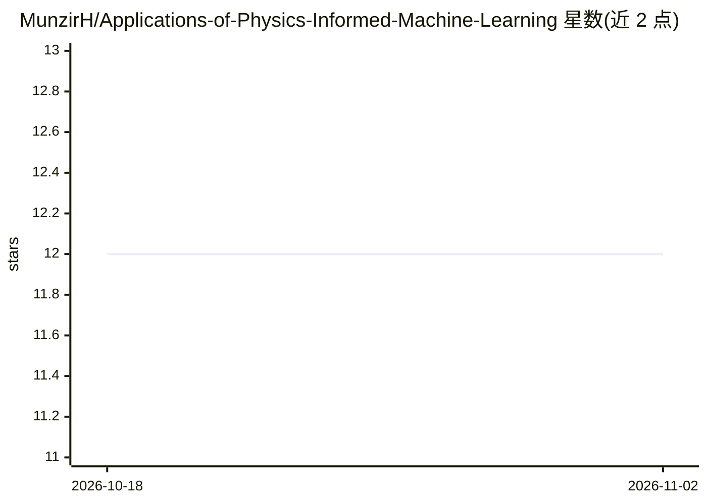

# MunzirH/Applications-of-Physics-Informed-Machine-Learning

⭐ 12 · Python · 推送 2026-04-29 · [GitHub](https://github.com/MunzirH/Applications-of-Physics-Informed-Machine-Learning) · 个人维护

**SINDy 稀疏识别非线性动力学方程的 Python 实现：从数据恢复控制方程**

复现 Brunton/Proctor/Kutz 论文核心思想的可运行实现：对动力学系统的状态测量数据构建多项式候选项库，用序列阈值最小二乘（STLSQ）稀疏回归识别出主导动力学项，从而恢复控制方程。包含线性系统、Lorenz、三次振子、logistic 映射、Hopf 正规形等示例与系数恢复测试，示例均用合成数据，无需外部数据文件。以 pip 可编辑安装的 Python 包提供，附 notebook 讲解工作流。旧版混合 TensorFlow 1 的 notebook 已归档至 docs，不在主路径。

## 筛选速览

| 维度 | 判定 | 备注 |
|---|---|---|
| AI 角色 | `ai-native` | 本体是模型或模型工具 |
| 许可风险 | `none` | — |
| 部署形态 | `library` | 以包/库形式分发 |
| 模型依赖 | — | README 未给出锁定关系 |
| 硬件要求 | — | 无带数字的原话,不猜 |
| 安装摩擦 | `low` | 无编译、无系统依赖或容器化 |
| 成熟度 | — | 结构信号不足 |

## 能力要点

- 多项式候选库 + 有限差分求导 + STLSQ 稀疏回归的完整 SINDy 流程
- 覆盖论文 10 类主题的示例（Lorenz/logistic 映射/Hopf/噪声数据/阈值扫描）
- 测试验证在已知系统上的系数恢复
- 示例全部使用合成数据，无需外部数据文件

## 适用场景

- 从仿真或测量数据中辨识系统控制方程
- 学习 SINDy 方法并通过 notebook 走完整工作流
- 复现 Brunton 2016 论文的核心实验

## 场景标签

 · 领域:科学计算/物理信息机器学习

## 证据(README 行号)

> L7: The project focuses on Sparse Identification of Nonlinear Dynamics (SINDy): given measurements of a dynamical system
> L14: - Sequential thresholded least squares (STLSQ)

## 星数曲线

2026-10-18 12 → 2026-11-02 12（+0）

---
*卡片 v1 · prompt 1.4 · 生成 2026-11-01 · 置信度 high · 依据 README sha `6cac6da8b798` · [字段定义](../../DATASET.md)*
