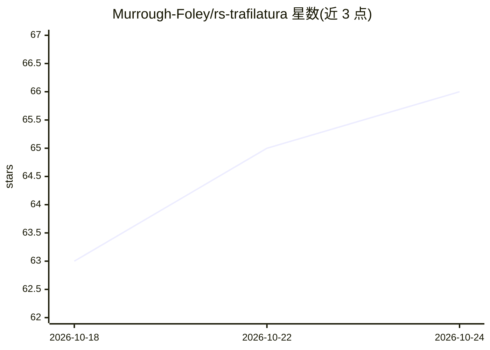

# Murrough-Foley/rs-trafilatura

⭐ 67 · Rust · Apache-2.0 · 推送 2026-04-03 · [GitHub](https://github.com/Murrough-Foley/rs-trafilatura) · 个人维护

**Rust 网页正文抽取库：分类页面类型并输出净内容与置信度**

trafilatura 的 Rust 移植，从网页 HTML 中去除样板、导航与广告后抽取正文，输出纯文本/HTML/Markdown 及元数据（标题、作者、日期等）。内置两套 XGBoost 模型：200 树 181 特征的分类器识别 7 种页面类型（文章、论坛、商品等），并按类型使用专门抽取配置（含 12 个论坛平台、4 个文档框架适配）；27 特征的模型预测抽取质量置信度，低于 0.80 的页面可转 LLM 兜底。以 Cargo crate 提供，含 CLI 二进制与 spider 爬虫集成 feature。ScrapingHub 基准 F1 0.966。

## 筛选速览

| 维度 | 判定 | 备注 |
|---|---|---|
| AI 角色 | `ai-native` | 本体是模型或模型工具 |
| 许可风险 | `permissive` | Apache-2.0 |
| 部署形态 | `None` |  |
| 模型依赖 | — | README 未给出锁定关系 |
| 硬件要求 | — | 无带数字的原话,不猜 |
| 安装摩擦 | `low` | 无编译、无系统依赖或容器化 |
| 成熟度 | — | 结构信号不足 |

## 能力要点

- XGBoost 分类器识别 7 种页面类型并按类型抽取
- ML 抽取质量预测（0.0-1.0），低于 0.80 建议走 LLM 兜底
- 输出 GitHub Flavored Markdown 与丰富元数据（JSON-LD/OG/Dublin Core）
- spider 爬虫集成 feature 与 extract_stdin CLI 二进制

## 适用场景

- 爬虫或搜索引擎管道中批量抽取网页正文
- 为 LLM/RAG 数据准备清洗网页内容，低置信度页面转 LLM 兜底
- 按页面类型（论坛/商品/文档）分别抽取结构化内容

## 场景标签

`网页抓取` `文档解析` · 领域:效率与自动化

## 证据(README 行号)

> L11: - **Page Type Classification**: XGBoost classifier (200 trees, 181 features) detects 7 page types: article, forum, 
> L13: - **Extraction Quality Predictor**: ML-based confidence scoring (0.0-1.0) using a 27-feature XGBoost model that pre

## 星数曲线

2026-10-18 63 → 2026-10-24 66（+3）

---
*卡片 v1 · prompt 1.4 · 生成 2026-10-24 · 置信度 high · 依据 README sha `bcea99f14ec1` · [字段定义](../../DATASET.md)*
