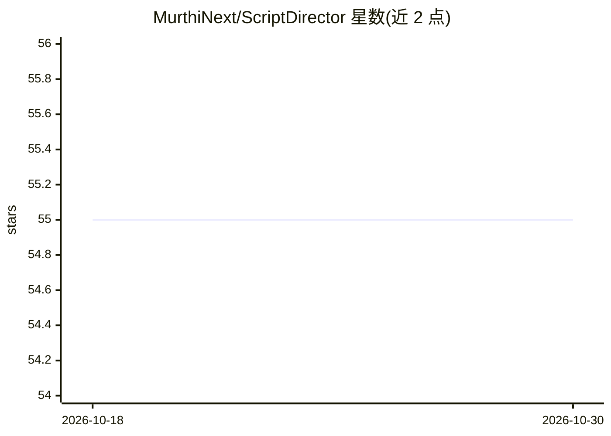

# MurthiNext/ScriptDirector

⭐ 55 · Python · MIT · 推送 2026-08-14 · [GitHub](https://github.com/MurthiNext/ScriptDirector) · [官网](https://www.bilibili.com/video/BV1mzXVBmE9J) · 个人维护 · 中文 README

**把音频与台本自动对齐，生成带时间戳字幕的工具**

利用 Faster Whisper / Stable Whisper 做语音识别，得到单词级时间戳，再用增强的 Needleman-Wunsch 动态规划算法把识别结果与台本句子匹配并插值时间码，输出 SRT/LRC 字幕。支持日/中/英等语言台本分割、短句模式、按标点拆分长句，以及不重新识别的只对齐模式（已有 SRT/LRC 与台本重新对齐）。提供 CLI 与 customtkinter GUI，可直接输入视频文件（经 ffmpeg 提取音频）。运行需 Python 3.9+、ffmpeg，CUDA 可选。

## 筛选速览

| 维度 | 判定 | 备注 |
|---|---|---|
| AI 角色 | `ai-native` | 本体是模型或模型工具 |
| 许可风险 | `permissive` | MIT |
| 部署形态 | `desktop` | 安装包/桌面程序 |
| 模型依赖 | — | README 未给出锁定关系 |
| 硬件要求 | — | 无带数字的原话,不猜 |
| 安装摩擦 | `medium` | 含编译或系统依赖之一 |
| 成熟度 | — | 结构信号不足 |

## 能力要点

- 增强 Needleman-Wunsch 对齐算法（NumPy 优化、预计算相似度矩阵）
- 支持单词级时间戳与短句模式
- 只对齐模式：已有字幕（SRT/LRC）与台本重新对齐，无需语音识别
- CLI 与 GUI 双入口，支持视频输入自动提取音频

## 适用场景

- 我有台本和录音，想自动生成时间轴准确的字幕
- 修正自动生成字幕的时间轴或转换 SRT/LRC 格式
- 直接用视频文件生成与台本对齐的字幕

## 场景标签

`语音识别` · 领域:感知与多模态

## 证据(README 行号)

> L3: ### Script Director 是一个将音频文件与台本（文本）自动对齐，生成带时间戳字幕的工具。它利用 **Faster Whisper / Stable Whisper** 进行语音识别，并通过 **Needleman-W
> L7: - 🎙️ 基于 Stable Whisper 的高质量语音识别，支持单词级时间戳

## 星数曲线

2026-10-18 55 → 2026-10-30 55（+0）

---
*卡片 v1 · prompt 1.4 · 生成 2026-10-24 · 置信度 mid · 依据 README sha `fd3d06937c01` · [字段定义](../../DATASET.md)*
