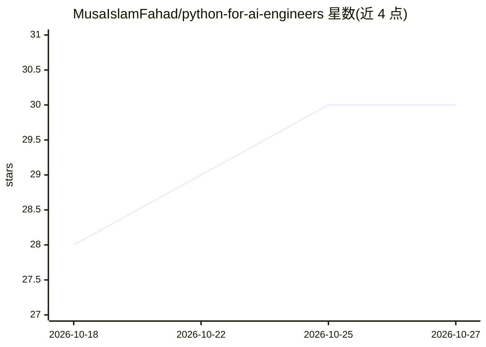

# MusaIslamFahad/python-for-ai-engineers

⭐ 30 · Jupyter Notebook · MIT · 推送 2026-06-06 · [GitHub](https://github.com/MusaIslamFahad/python-for-ai-engineers) · 个人维护

**面向 AI 工程师的 Python 实践课程：80+ 交互式 Jupyter 笔记本**

以 8 个递进模块组织的开源 Python 课程，从基础语法、数据科学栈（NumPy/Pandas）、机器学习与深度学习（Scikit-learn/PyTorch/TensorFlow），到 LLM、RAG、向量数据库与 Agent 的 AI 工程内容，并含 6 个端到端项目。每个笔记本遵循统一模板（定义、AI 语境、语法、渐进示例、常见错误）。提供 Google Colab、本地 git clone 与 GitHub Codespaces 三种运行方式，Python 3.10+，依赖见 requirements.txt。作者为达卡 Daffodil International University 的个人开发者。

## 筛选速览

| 维度 | 判定 | 备注 |
|---|---|---|
| AI 角色 | `ai-knowledge` | 知识聚合/清单类 |
| 许可风险 | `permissive` | MIT |
| 部署形态 | `library` | 以包/库形式分发 |
| 模型依赖 | — | README 未给出锁定关系 |
| 硬件要求 | — | 无带数字的原话,不猜 |
| 安装摩擦 | `medium` | 含编译或系统依赖之一 |
| 成熟度 | — | 结构信号不足 |

## 能力要点

- 80+ 可运行、带注释的 Jupyter 笔记本，覆盖 8 个递进模块
- 每个主题均以 AI/ML 工程语境引入，统一笔记本模板
- 含 RAG 问答系统、AI 研究 Agent 等 6 个端到端项目
- 支持 Google Colab / 本地 / Codespaces 三种学习环境

## 适用场景

- 零基础按模块路径系统学习面向 AI 工程的 Python
- 已有开发经验者按建议路径转岗 AI 工程
- 直接在 Colab 中免配置运行课程笔记本

## 场景标签

`教程课程` · 领域:学习与行业

## 证据(README 行号)

> L28: - 📓 **80+ Jupyter Notebooks**: interactive, runnable, annotated
> L40: |#|Module|Topics Covered|Level|Notebooks|

## 星数曲线

2026-10-18 28 → 2026-10-27 30（+2）

---
*卡片 v1 · prompt 1.4 · 生成 2026-10-26 · 置信度 mid · 依据 README sha `8a711901f679` · [字段定义](../../DATASET.md)*
