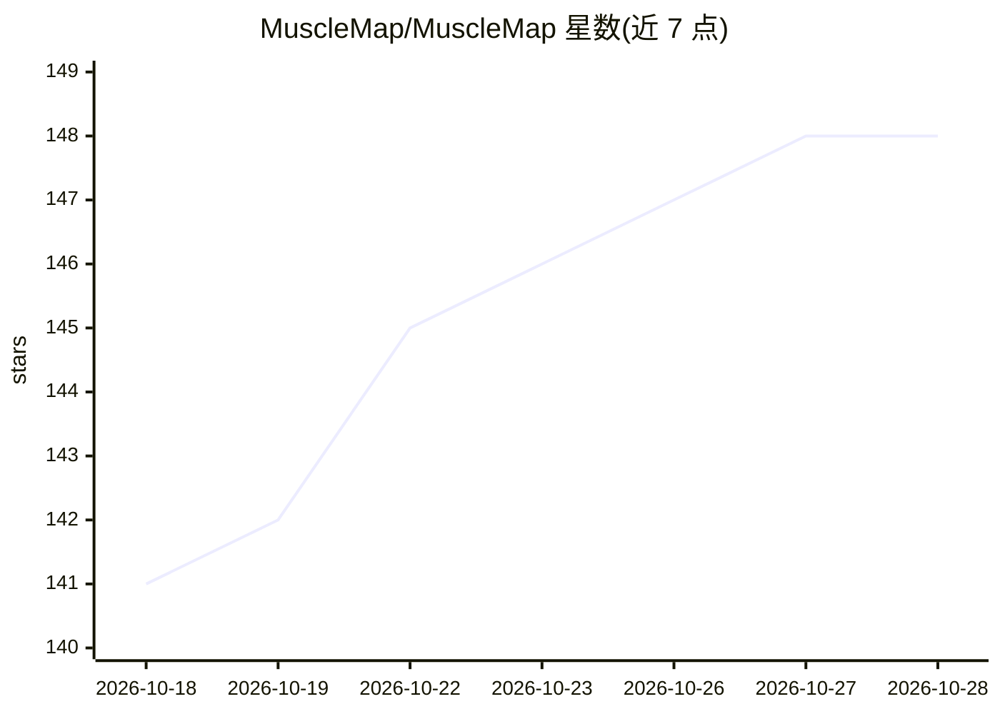

# MuscleMap/MuscleMap

⭐ 148 · Python · MIT · 推送 2026-10-25 · [GitHub](https://github.com/MuscleMap/MuscleMap) · [官网](https://musclemap.github.io/MuscleMap/) · 组织维护

**全身肌肉 MRI/CT 分割与定量分析的开源工具箱，面向科研用户**

社区支持联盟 MuscleMap 提供的免费开源软件工具箱，对全身 MRI/CT 图像执行自动肌肉分割与成分定量分析。核心命令 mm_segment 使用对比度无关的全身分割模型（113 个肌肉与骨骼标签），mm_extract_metrics 支持 GMM/kmeans 聚类、Dixon 脂水分离与 CT 平均值提取，mm_register_to_template 做模板配准；另有 mm_gui 图形界面，并以 3D Slicer 扩展和 NeuroDesk 环境提供无需编程的使用途径。模型权重与模板从 Zenodo 自动下载；建议对分割结果做人工可视化校正。正在扩展手臂、手、脊柱等区域。

## 筛选速览

| 维度 | 判定 | 备注 |
|---|---|---|
| AI 角色 | `ai-native` | 本体是模型或模型工具 |
| 许可风险 | `permissive` | MIT |
| 部署形态 | `library` | 以包/库形式分发 |
| 模型依赖 | — | README 未给出锁定关系 |
| 硬件要求 | `cpu-ok` | |
| 安装摩擦 | `medium` | 含编译或系统依赖之一 |
| 成熟度 | — | 结构信号不足 |

## 能力要点

- 对比度无关全身分割模型，113 个肌肉与骨骼标签，支持 MRI 与 CT
- mm_extract_metrics 支持 GMM/kmeans、Dixon 脂水与 CT 平均值定量
- 提供 GUI 及 3D Slicer 扩展、NeuroDesk 无代码使用途径
- 模型权重与模板图像从 Zenodo 自动下载，CPU/GPU 均可运行

## 适用场景

- 对全身 MRI/CT 图像批量自动分割肌肉并提取形态与成分指标
- 做肌少症、肌肉健康相关的影像组学研究
- 不写代码，通过 3D Slicer 或 NeuroDesk 完成肌肉分割

## 场景标签

`科研工具` `图像视频处理` · 领域:学习与行业

## 证据(README 行号)

> L10: A free and open-source software toolbox for whole-body muscle segmentation and analysis.
> L122:  * mm_segment uses our contrast agnostic whole-body segmentation model by default with currently 113 muscles and b
> L163:  mm_extract_metrics -m gmm -r wholebody -i image.nii.gz -s image_dseg.nii.gz -c 3

## 星数曲线

2026-10-18 141 → 2026-10-28 148（+7）

---
*卡片 v1 · prompt 1.4 · 生成 2026-10-22 · 置信度 high · 依据 README sha `840159cd79ed` · [字段定义](../../DATASET.md)*
