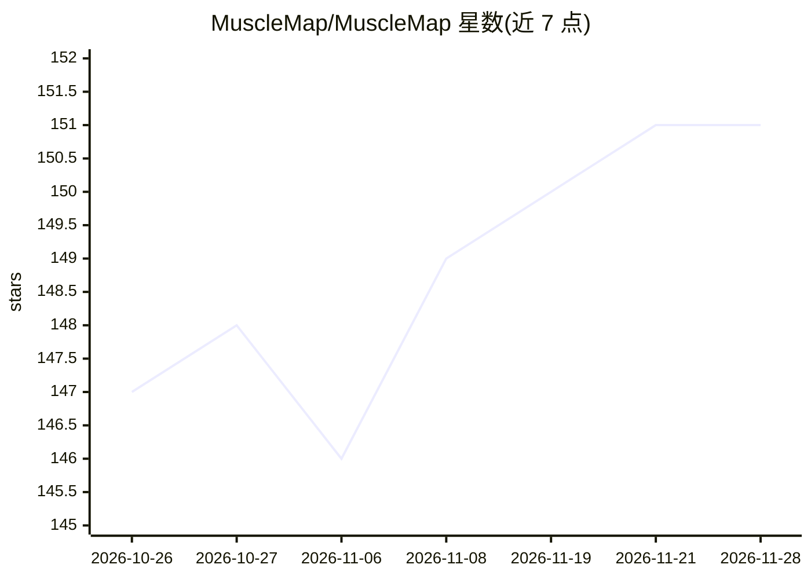

# MuscleMap/MuscleMap

⭐ 151 · Python · MIT · 推送 2026-11-12 · [GitHub](https://github.com/MuscleMap/MuscleMap) · [官网](https://musclemap.github.io/MuscleMap/) · 组织维护

**面向科研人员的全身肌肉 MRI/CT 自动分割与指标提取工具箱**

开源的全身肌肉分割与分析工具箱，隶属 MuscleMap 联盟项目。核心命令 mm_segment 调用对比度无关的全身分割模型，覆盖 113 块肌肉与骨骼，输出 NIfTI 分割图与 JSON sidecar；mm_extract_metrics 支持 T1w/T2w、Dixon 脂水分离及脂肪分数（MRI/CT）的成分分析（GMM/kmeans）；另提供 GUI（mm_gui）与模板配准（mm_register_to_template）。可通过 conda+pip 源码安装，也可作为 3D Slicer 扩展或在 NeuroDesk 环境使用；默认 CPU 版 PyTorch，GPU 需手动安装对应 CUDA/ROCm 版本；模型权重与模板从 Zenodo 首次使用时自动下载。

## 筛选速览

| 维度 | 判定 | 备注 |
|---|---|---|
| AI 角色 | `ai-native` | 本体是模型或模型工具 |
| 许可风险 | `permissive` | MIT |
| 部署形态 | `library` | 以包/库形式分发 |
| 模型依赖 | — | README 未给出锁定关系 |
| 硬件要求 | `cpu-ok` | |
| 安装摩擦 | `medium` | 含编译或系统依赖之一 |
| 成熟度 | — | 结构信号不足 |

## 能力要点

- 对比度无关的全身分割模型，覆盖 113 块肌肉与骨骼
- 支持 T1w/T2w、Dixon 脂水 MRI 及 CT 的成分指标提取（GMM/kmeans）
- 提供 CLI、GUI（mm_gui）及 3D Slicer 扩展、NeuroDesk WebApp 等多种使用方式
- 模型版本可指定，权重从 Zenodo 自动下载；支持 GPU 加速与 CPU 回退

## 适用场景

- 对全身 MRI/CT 影像批量做肌肉分割与体成分分析
- 无编程背景时用 3D Slicer 扩展或 NeuroDesk WebApp 做自动分割
- 将 DICOM 数据整理为 BIDS 结构后跑分割与指标流水线
- 分割结果人工校正后反馈 issue 参与模型迭代

## 场景标签

`科研工具` `目标检测` · 领域:学习与行业

## 证据(README 行号)

> L10: A free and open-source software toolbox for whole-body muscle segmentation and analysis.
> L122:  * mm_segment uses our contrast agnostic whole-body segmentation model by default with currently 113 muscles and b

## 星数曲线

2026-10-26 147 → 2026-11-28 151（+4）

---
*卡片 v1 · prompt 1.4 · 生成 2026-11-27 · 置信度 high · 依据 README sha `052f7892d122` · [字段定义](../../DATASET.md)*
