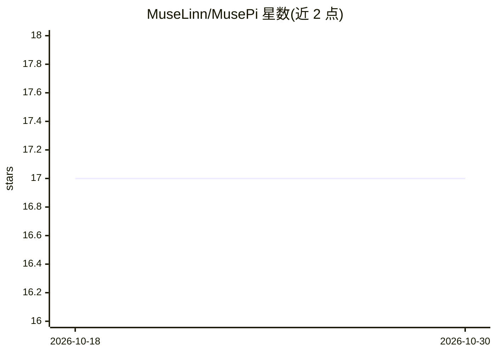

# MuseLinn/MusePi

⭐ 17 · TypeScript · MIT · 推送 2026-10-29 · [GitHub](https://github.com/MuseLinn/MusePi) · [官网](https://muselinn.github.io/MusePi/) · 个人维护 · 中文 README

**桌面优先的 AI 编程智能体：Electron GUI + TUI/CLI + 守护进程**

独立维护的编码智能体平台，提供三个使用面：Electron 桌面客户端、终端 TUI/CLI、以及常驻守护进程（musepi serve，GUI 通过 JSON-RPC 与之通信，会话可持久化并跨 GUI 重启恢复）。核心引擎支持 60+ LLM 提供商、32 个内置工具（文件、LSP/DAP 代码智能、并行子代理、浏览器/桌面控制、记忆与技能）、MCP 相关生态与 magic keywords 会话控制。附带常驻桌面宠物、Android 伴侣应用（局域网配对）、任务中心定时调度与技能安装机制。主题标签含 moonshot 与 pi-fork，声明自身为独立上游。

## 筛选速览

| 维度 | 判定 | 备注 |
|---|---|---|
| AI 角色 | `ai-native` | 本体是模型或模型工具 |
| 许可风险 | `permissive` | MIT |
| 部署形态 | `desktop` | 安装包/桌面程序 |
| 模型依赖 | — | README 未给出锁定关系 |
| 硬件要求 | — | 无带数字的原话,不猜 |
| 安装摩擦 | `low` | 无编译、无系统依赖或容器化 |
| 成熟度 | — | 结构信号不足 |

## 能力要点

- 60+ LLM 提供商、32 个内置工具（LSP/DAP、子代理、浏览器/桌面控制、记忆）
- Electron GUI + TUI/CLI + 守护进程三面架构，会话持久化与恢复
- Android 伴侣应用（局域网配对）与桌面宠物交互面
- 任务中心：cron 式定时调度（IANA 时区、DST 安全）

## 适用场景

- 在桌面 GUI 或终端中用自然语言驱动代码编辑、调试与运行
- 通过并行子代理与工作树隔离处理多阶段任务
- 手机端配对远程查看/继续会话
- 定时执行代理任务并追踪运行历史

## 场景标签

`编码 Agent` · 领域:编码与开发

## 证据(README 行号)

> L17: MusePi is a **standalone coding-agent platform** with an **Electron desktop GUI, a daemon service, and an always-on
> L96: - **60+ LLM providers**, 32 built-in tools, `xd://` device extensions.

## 星数曲线

2026-10-18 17 → 2026-10-30 17（+0）

---
*卡片 v1 · prompt 1.4 · 生成 2026-10-30 · 置信度 high · 依据 README sha `e1baa58c6a1f` · [字段定义](../../DATASET.md)*
