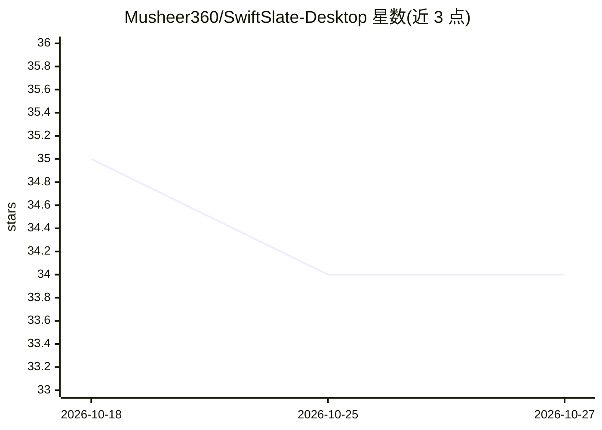

# Musheer360/SwiftSlate-Desktop

⭐ 34 · Python · MIT · 推送 2026-09-23 · [GitHub](https://github.com/Musheer360/SwiftSlate-Desktop) · 个人维护

**Windows 全局 AI 文本改写工具：任意应用内触发词即时替换文本**

面向 Windows 桌面用户的系统级文本变换工具：通过 Windows Raw Input API 监听全局键盘输入，用户在任意应用的文本框末尾输入如 ?fix、?formal、?translate:es 等触发词，AI 响应经 Ctrl+A/Ctrl+V 直接替换原文本。内置 9 个 AI 命令、离线文本替换器与剪贴板命令，支持 Google Gemini、Groq 及任意 OpenAI 兼容端点（含 Ollama、LM Studio、vLLM 等本地 LLM）。提供多 API key 轮换、配置热重载、自定义命令；限制：仅支持 Windows 10/11 64 位，启动需至少一个 API key，replacer-shell 命令无沙箱运行。

## 筛选速览

| 维度 | 判定 | 备注 |
|---|---|---|
| AI 角色 | `ai-native` | 本体是模型或模型工具 |
| 许可风险 | `permissive` | MIT |
| 部署形态 | `desktop` | 安装包/桌面程序 |
| 模型依赖 | local-ok | 支持本地模型 |
| 硬件要求 | — | 无带数字的原话,不猜 |
| 安装摩擦 | `low` | 无编译、无系统依赖或容器化 |
| 成熟度 | — | 结构信号不足 |

## 能力要点

- Raw Input API 系统级监听，任意应用内行内替换文本
- 9 个内置 AI 命令 + 离线替换器 + 剪贴板命令
- 多 API key 轮换，429/401/403 自动处理
- 兼容任意 OpenAI 兼容端点，支持本地 LLM（Ollama/LM Studio/vLLM）

## 适用场景

- 在聊天、邮件等任意应用里即时修正语法或改写语气
- 不切换应用完成多语言翻译
- 配置本地命令快速插入签名、邮箱等固定文本

## 场景标签

`AI 写作` · 领域:内容生成

## 证据(README 行号)

> L3: ### System-wide AI text transformation for Windows
> L26: You type:     "i dont no whats hapening ?fix"
> L28: Result:       "I don't know what's happening."

## 星数曲线

2026-10-18 35 → 2026-10-27 34（-1）

---
*卡片 v1 · prompt 1.4 · 生成 2026-10-25 · 置信度 high · 依据 README sha `d1584507324f` · [字段定义](../../DATASET.md)*
