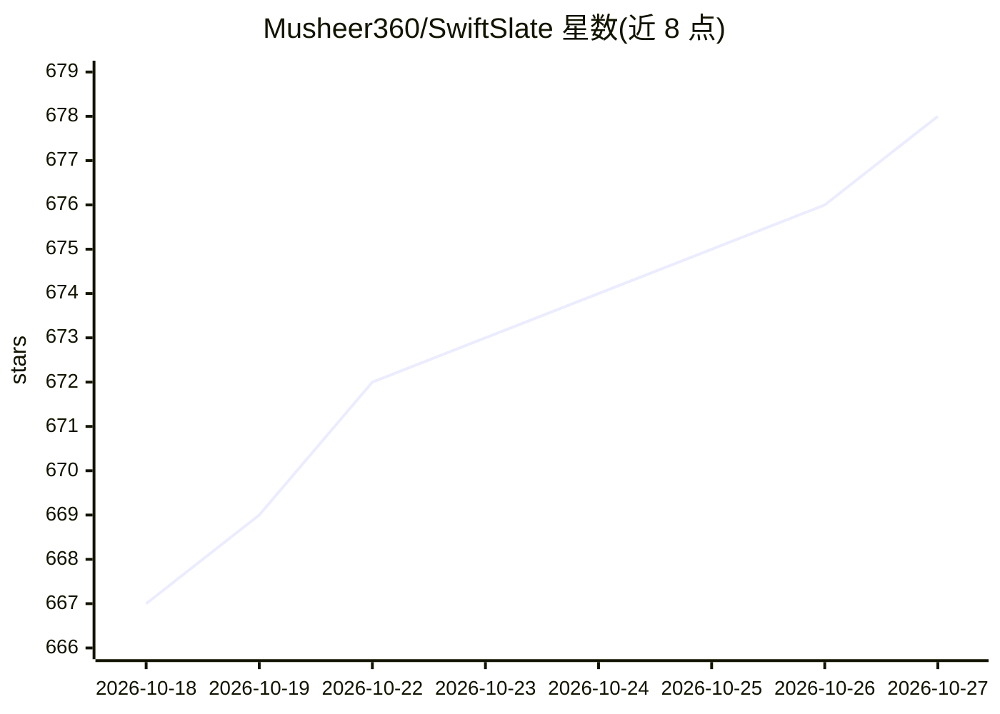

# Musheer360/SwiftSlate

⭐ 678 · Kotlin · MIT · 推送 2026-10-16 · [GitHub](https://github.com/Musheer360/SwiftSlate) · 个人维护

**Android 全局 AI 文本改写助手：任意应用内输入触发词即时改写文本**

基于 Android 无障碍服务的系统级文本处理应用：用户在任意应用的输入框末尾输入 ?fix、?translate:es 等触发词，应用检测后将文本发送至 Gemini、Groq 或任意 OpenAI 兼容端点（含 Ollama/LM Studio/vLLM 本地模型），并把结果原地替换回输入框。另提供免 API key 的离线文本替换命令、剪贴板命令、文本选择菜单入口、多 key 轮换与 AES-256-GCM 密钥加密存储。要求 Android 6.0+，部分自定义输入框的应用可能不被支持。

## 筛选速览

| 维度 | 判定 | 备注 |
|---|---|---|
| AI 角色 | `ai-native` | 本体是模型或模型工具 |
| 许可风险 | `permissive` | MIT |
| 部署形态 | `None` |  |
| 模型依赖 | local-ok | 支持本地模型 |
| 硬件要求 | — | 无带数字的原话,不猜 |
| 安装摩擦 | `medium` | 含编译或系统依赖之一 |
| 成熟度 | — | 结构信号不足 |

## 能力要点

- 无障碍服务系统级触发词检测，9 个内置 AI 命令 + 动态翻译
- 多供应方：Gemini/Groq/任意 OpenAI 兼容端点（含本地 Ollama、LM Studio、vLLM）
- API key 以 AES-256-GCM 加密存储于 Android Keystore，多 key 自动轮换
- 离线文本替换命令零延迟运行，无需 API key 与网络

## 适用场景

- 在聊天、邮件等任意应用内直接修正语法或调整语气，无需切换应用
- 即时将消息翻译为其他语言后原地替换
- 用本地 LLM 端点做文本改写，避免数据出网
- 配置签名、常用回复等离线快速插入片段

## 场景标签

`AI 写作` · 领域:内容生成

## 证据(README 行号)

> L5: ### System-wide AI text assistant for Android — powered by Gemini, Groq, and any OpenAI-compatible endpoint
> L79: Ships with Google Gemini, Groq, or connect **any OpenAI-compatible endpoint** — cloud providers, or **local LLMs** 

## 星数曲线

2026-10-18 667 → 2026-10-27 678（+11）

---
*卡片 v1 · prompt 1.4 · 生成 2026-10-21 · 置信度 high · 依据 README sha `3747c1030190` · [字段定义](../../DATASET.md)*
