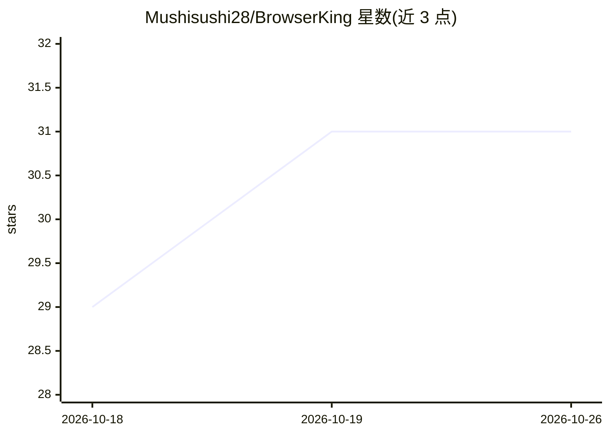

# Mushisushi28/BrowserKing

⭐ 31 · JavaScript · 推送 2026-03-18 · [GitHub](https://github.com/Mushisushi28/BrowserKing) · 个人维护

**多模型浏览器 agent Chrome 扩展：用任意 LLM 控制浏览器操作**

开源 Chrome 扩展，让任意 LLM 充当浏览器 agent：截图理解页面、点击/输入/滚动、读取内容、跨标签页工作，并支持录制与回放工作流（可导出 GIF）。用户自带 API key，支持 OpenAI、Anthropic、Google、xAI、DeepSeek、Mistral、Groq 等 20+ 云端模型，也可通过 OpenAI 兼容端点接入 Ollama/LM Studio 等本地推理服务。内部通过拦截 Anthropic API 调用并实时翻译为 OpenAI 兼容 chat/completions 请求实现多后端统一。本地模型支持为实验性，需开发者模式加载未打包扩展安装。

## 筛选速览

| 维度 | 判定 | 备注 |
|---|---|---|
| AI 角色 | `ai-native` | 本体是模型或模型工具 |
| 许可风险 | `none` | — |
| 部署形态 | `None` |  |
| 模型依赖 | local-ok | 支持本地模型 |
| 硬件要求 | — | 无带数字的原话,不猜 |
| 安装摩擦 | `low` | 无编译、无系统依赖或容器化 |
| 成熟度 | `idea` | |

## 能力要点

- 20+ 云端模型多供应商切换，用户自带 API key
- 通过 OpenAI 兼容端点接入 Ollama/LM Studio/LocalAI 等本地模型
- 浏览器自动化工具集：截图、点击、输入、滚动、跨标签页、工作流录制回放
- Anthropic ↔ OpenAI API 实时翻译层与 SSE 流式转换

## 适用场景

- 让 AI 代我完成网页查找、表单填写等重复操作
- 换不同供应商的模型执行同一个浏览器任务
- 用本地模型跑浏览器 agent，不把数据发给云端

## 场景标签

`浏览器自动化` · 领域:效率与自动化

## 证据(README 行号)

> L5:  Open-source browser agent Chrome extension powered by any LLM provider
> L11: BrowserKing is a Chrome extension that gives any LLM the ability to see and control your browser. It works like a h

## 星数曲线

2026-10-18 29 → 2026-10-26 31（+2）

---
*卡片 v1 · prompt 1.4 · 生成 2026-10-26 · 置信度 high · 依据 README sha `734cc5c57e65` · [字段定义](../../DATASET.md)*
