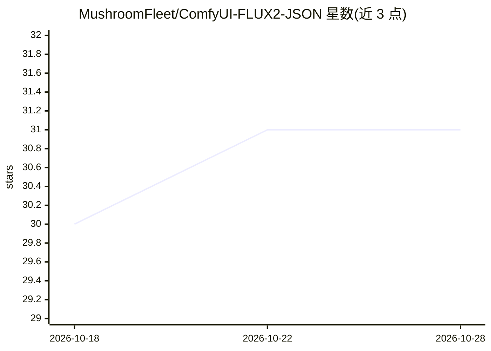

# MushroomFleet/ComfyUI-FLUX2-JSON

⭐ 31 · Python · MIT · 推送 2026-04-07 · [GitHub](https://github.com/MushroomFleet/ComfyUI-FLUX2-JSON) · 个人维护

**ComfyUI 自定义节点集：构建 FLUX.2 结构化 JSON 提示词**

为 ComfyUI 提供的 6 个自定义节点（v1.0.0 Phase 1），用于以类型安全参数组装 FLUX.2 图像生成的结构化 JSON 提示词：SceneBuilder 定义场景、StyleSelector 选择风格、SubjectCreator/SubjectArray 管理主体、CameraRig 控制相机参数，最终由 PromptAssembler 输出 JSON 字符串或 Python dict，供复制到 FLUX.2 使用。输出为提示词 JSON 而非图像本身；安装需 ComfyUI 环境，支持 Manager、git clone 或 ZIP 手动安装。路线图中的视觉控制、高级相机等功能标注为 Coming Soon。

## 筛选速览

| 维度 | 判定 | 备注 |
|---|---|---|
| AI 角色 | `ai-ecosystem` | LLM/agent 周边工具 |
| 许可风险 | `permissive` | MIT |
| 部署形态 | `None` |  |
| 模型依赖 | — | README 未给出锁定关系 |
| 硬件要求 | — | 无带数字的原话,不猜 |
| 安装摩擦 | `low` | 无编译、无系统依赖或容器化 |
| 成熟度 | `idea` | |

## 能力要点

- 6 个节点覆盖场景/风格/主体/相机参数的结构化组装
- PromptAssembler 输出 json_string 与 Python dict 两种形式
- 相机预设（85mm/f2.0 人像等）与镜头/光圈参考指南
- 十六进制颜色校验、位置辅助字段等参数规范

## 适用场景

- 在 ComfyUI 中为 FLUX.2 组装结构化 JSON 提示词
- 精确控制图像生成的相机、主体与场景参数
- 构建多主体（最多 8 个）的产品摄影类工作流

## 场景标签

`提示工程` · 领域:Agent 开发

## 证据(README 行号)

> L7: A comprehensive suite of custom nodes for building structured JSON prompts for FLUX.2 image generation with precisio
> L13: - **FLUX2_PromptAssembler** 🎯 - Master output node for final JSON assembly
> L80: - `json_string`: Formatted JSON text (copy this to FLUX.2)

## 星数曲线

2026-10-18 30 → 2026-10-28 31（+1）

---
*卡片 v1 · prompt 1.4 · 生成 2026-10-26 · 置信度 high · 依据 README sha `018feb8bef1b` · [字段定义](../../DATASET.md)*
