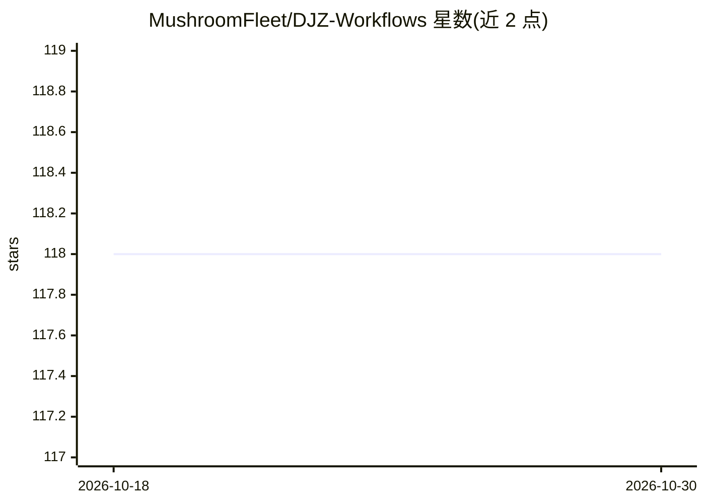

# MushroomFleet/DJZ-Workflows

⭐ 118 · Python · 推送 2026-04-07 · [GitHub](https://github.com/MushroomFleet/DJZ-Workflows) · [官网](http://www.scuffedepoch.com) · 个人维护

**1000+ ComfyUI 工作流合集，覆盖 AI 图像与视频生成**

由 Drift Johnson 等人维护的 ComfyUI 工作流集合仓库：按包组织超过 1000 个工作流，覆盖文生视频（Cosmos、CogVideo、Hunyuan）、SDXL 图像生成、Flux（含 ControlNet、修复、IP Adapter、放大）、3D 生成（TripoSR、Zero123）、音频处理与反应式视觉生成等。每个工作流包配有 YouTube 教程视频，多数工作流在注释中附教程链接。安装方式为在 ComfyUI 工作流目录内 git clone 本仓库。

## 筛选速览

| 维度 | 判定 | 备注 |
|---|---|---|
| AI 角色 | `ai-knowledge` | 知识聚合/清单类 |
| 许可风险 | `none` | — |
| 部署形态 | `None` |  |
| 模型依赖 | — | README 未给出锁定关系 |
| 硬件要求 | — | 无带数字的原话,不猜 |
| 安装摩擦 | `low` | 无编译、无系统依赖或容器化 |
| 成熟度 | — | 结构信号不足 |

## 能力要点

- 按主题组织的工作流包：文生视频、SDXL、Flux、3D 生成、音频集成、放大等
- 包含 ControlNet、Inpainting、IP Adapter、模型合并与训练工具工作流
- 每个工作流包关联 YouTube 教程视频
- 通过 git clone 到 ComfyUI workflows 目录安装，git pull 更新

## 适用场景

- 为 ComfyUI 查找现成的图像/视频生成工作流
- 学习各类生成工作流（Flux、SDXL、Hunyuan 等）的搭建方式
- 获取放大、修复、换脸、音频反应视频等专门用途工作流

## 场景标签

`图像生成` `视频生成` `教程课程` · 领域:内容生成

## 证据(README 行号)

> L2: A comprehensive collection of ComfyUI workflows from @driftjohnson @fivebelowfiveuk
> L6: This repository contains a vast collection of specialized workflow packs for ComfyUI, covering a wide range of AI im

## 星数曲线

2026-10-18 118 → 2026-10-30 118（+0）

---
*卡片 v1 · prompt 1.4 · 生成 2026-10-23 · 置信度 high · 依据 README sha `c1a3733b6986` · [字段定义](../../DATASET.md)*
