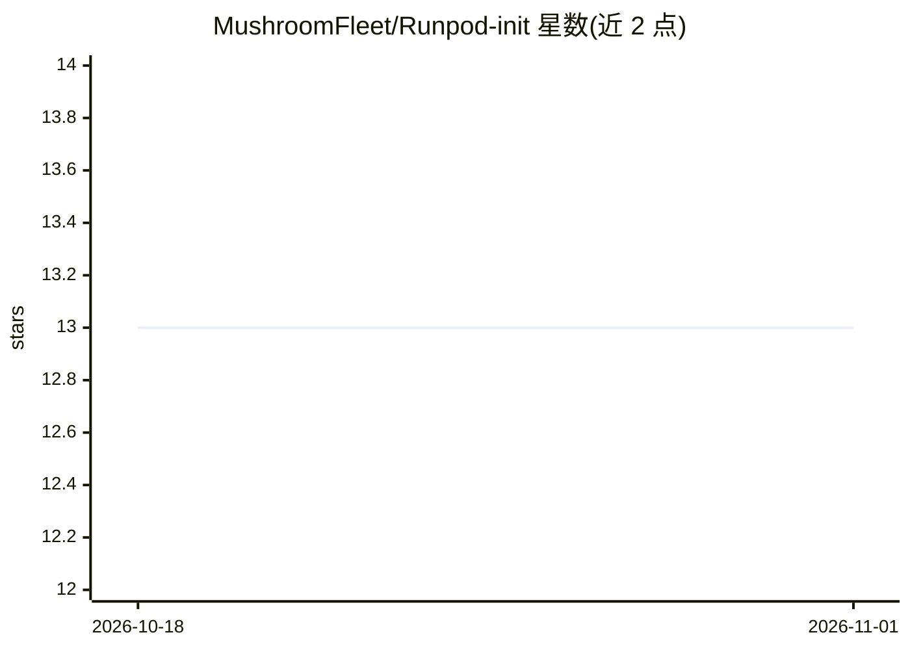

# MushroomFleet/Runpod-init

⭐ 13 · Shell · 推送 2026-04-07 · [GitHub](https://github.com/MushroomFleet/Runpod-init) · 个人维护

**RunPod GPU 实例的一键部署模板与初始化脚本合集**

面向 RunPod GPU 云实例的快速启动项目：提供 10 余个 RunPod 部署模板链接，覆盖 ComfyUI 的 FLUX-Dev/Schnell、WAN、Hunyuan Video、LTXV、MOCHI-1 等图像与视频生成工作流，以及 DJZ 音乐/语音、KohyaSS 与 OneTrainer 训练环境。仓库本身提供初始化 provisioning 脚本（如 default.sh，添加 Flux Dev 支持、作者 LoRA 与自定义节点包），通过 RunPod 环境变量字段在实例启动时执行。基础镜像来自 AI-Dock，需在 RunPod Secrets 配置 Hugging Face 读取密钥，部分 Pod 安装耗时较长。

## 筛选速览

| 维度 | 判定 | 备注 |
|---|---|---|
| AI 角色 | `ai-ecosystem` | LLM/agent 周边工具 |
| 许可风险 | `none` | — |
| 部署形态 | `None` |  |
| 模型依赖 | — | README 未给出锁定关系 |
| 硬件要求 | — | 无带数字的原话,不猜 |
| 安装摩擦 | `low` | 无编译、无系统依赖或容器化 |
| 成熟度 | `idea` | |

## 能力要点

- 10 余个 RunPod 模板覆盖 ComfyUI 图像/视频生成与训练环境
- provisioning 脚本经环境变量字段自动安装模型与自定义节点
- 支持通过 ComfyUI Manager 在安装后更新并重启

## 适用场景

- 在 RunPod 上一键部署 ComfyUI 图像或视频生成工作流
- 为 RunPod 实例配置启动时的模型下载与环境初始化
- 快速搭建 KohyaSS/OneTrainer 训练环境

## 场景标签

`图像生成` `视频生成` `微调` · 领域:内容生成

## 证据(README 行号)

> L5: ComfyUI FLUX-Dev/Schnell: https://runpod.io/console/deploy?template=25hd4rhmj7&ref=0czffee4
> L45: I will provide initialisation scripts if needed for various tasks in this repo.

## 星数曲线

2026-10-18 13 → 2026-11-01 13（+0）

---
*卡片 v1 · prompt 1.4 · 生成 2026-10-31 · 置信度 high · 依据 README sha `6d1018833ef5` · [字段定义](../../DATASET.md)*
