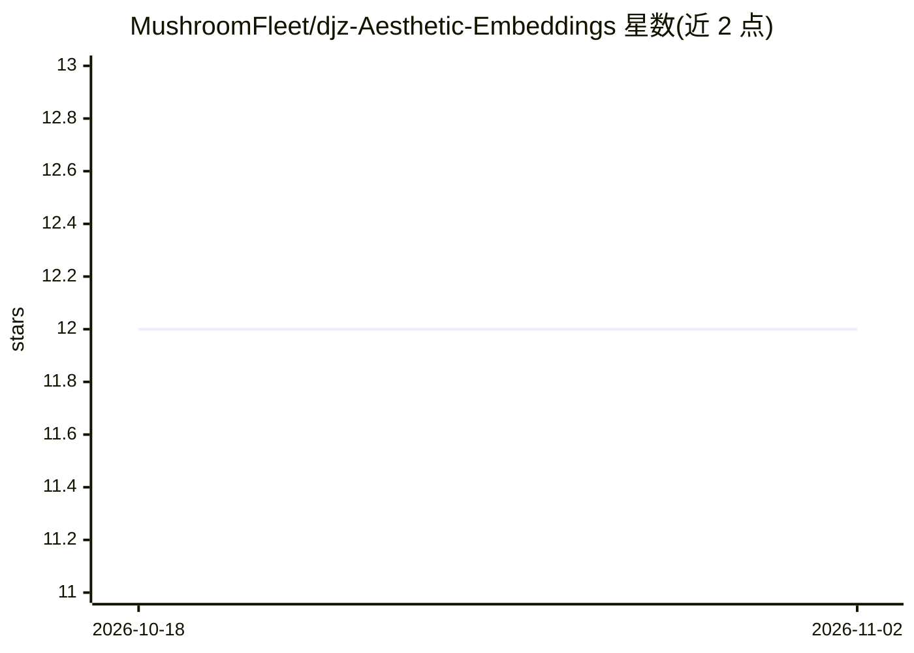

# MushroomFleet/djz-Aesthetic-Embeddings

⭐ 12 · 推送 2026-04-07 · [GitHub](https://github.com/MushroomFleet/djz-Aesthetic-Embeddings) · 个人维护

**Stable Diffusion 美学梯度嵌入合集，供 A1111 WebUI 使用**

面向 Automatic1111 Stable Diffusion WebUI（搭配 Aesthetic Gradients 扩展）的美学梯度嵌入（embedding）集合：以 git clone 到 WebUI 的 extensions/aesthetic-gradients/aesthetic_embeddings 目录方式部署，用于图像生成的风格迁移、质量评分与视觉微调。2022 年 11 月曾新增 13 个梯度（均使用 15 步），README 附对比截图，并引用 Aesthetic Gradients 论文（arXiv:2209.12330）。

## 筛选速览

| 维度 | 判定 | 备注 |
|---|---|---|
| AI 角色 | `ai-knowledge` | 知识聚合/清单类 |
| 许可风险 | `none` | — |
| 部署形态 | `None` |  |
| 模型依赖 | — | README 未给出锁定关系 |
| 硬件要求 | — | 无带数字的原话,不猜 |
| 安装摩擦 | `low` | 无编译、无系统依赖或容器化 |
| 成熟度 | — | 结构信号不足 |

## 能力要点

- 面向 Automatic1111 WebUI + Aesthetic Gradients 扩展的嵌入集合
- git clone 到 WebUI extensions 目录即完成部署
- 2022 年 11 月新增 13 个梯度（15 步设置）
- 引用 Gallego 2022 Aesthetic Gradients 论文

## 适用场景

- 为 Stable Diffusion 生成添加预设美学风格
- 配合 Aesthetic Gradients 扩展调节图像质量与观感
- 收集或对比不同美学梯度的生成效果

## 场景标签

`图像生成` · 领域:内容生成

## 证据(README 行号)

> L1: # Drift Johnson's Aesthetic Gradient Embeddings Repo
> L3: for Automatic1111's WebUI for Stable Diffusion with Aesthetic Gradient Extension
> L14:   git clone https://github.com/MushroomFleet/djz-Aesthetic-Embeddings extensions/aesthetic-gradients/aesthetic_embe

## 星数曲线

2026-10-18 12 → 2026-11-02 12（+0）

---
*卡片 v1 · prompt 1.4 · 生成 2026-11-01 · 置信度 high · 依据 README sha `6e44f10de3e9` · [字段定义](../../DATASET.md)*
