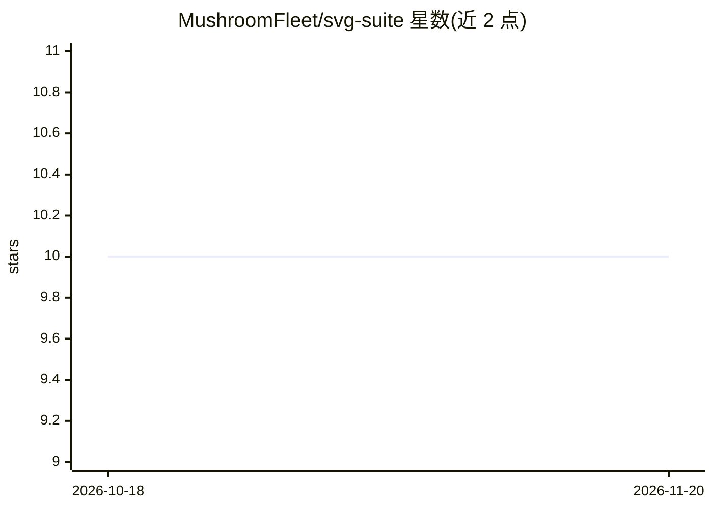

# MushroomFleet/svg-suite

⭐ 10 · Python · MIT · 推送 2026-04-07 · [GitHub](https://github.com/MushroomFleet/svg-suite) · 个人维护

**ComfyUI 的 SVG 转换与压缩优化节点套件**

一组 ComfyUI 自定义节点，在 ComfyUI-ToSVG 基础上扩展：将图像（文件路径、字节流）转换为 SVG，统一颜色/黑白转换模式并暴露 vtracer 全部参数；附带基于 SVGCompress 与 Scour 的压缩、优化节点，颜色提取/替换/批量变换节点，以及从 svgstore 目录加载 SVG 的 ZenkaiSVG 节点。运行需 ComfyUI 及 vtracer、torch、pymupdf 等十余个 Python 依赖。

## 筛选速览

| 维度 | 判定 | 备注 |
|---|---|---|
| AI 角色 | `ai-ecosystem` | LLM/agent 周边工具 |
| 许可风险 | `permissive` | MIT |
| 部署形态 | `None` |  |
| 模型依赖 | — | README 未给出锁定关系 |
| 硬件要求 | — | 无带数字的原话,不猜 |
| 安装摩擦 | `low` | 无编译、无系统依赖或容器化 |
| 成熟度 | — | 结构信号不足 |

## 能力要点

- 统一节点同时支持 color 与 binary 两种转换模式，参数动态适配
- 支持从文件路径或 JPG/PNG/WebP 原始字节直接转换
- SVG 压缩（delete/simplify/merge）与 Scour 优化、四档预设
- 颜色提取、定点替换与 invert/grayscale/sepia 批量变换

## 适用场景

- 在 ComfyUI 工作流中把生成的图像转为矢量 SVG
- 压缩和精简体积过大的 SVG 文件
- 批量修改 SVG 配色或提取用色

## 场景标签

`图像视频处理` · 领域:感知与多模态

## 证据(README 行号)

> L1: # SVG Suite for ComfyUI
> L3: SVG Suite is an advanced set of nodes for converting images to SVG in ComfyUI, expanding upon the functionality of C
> L137: 1. Add any of the nodes from the "💎TOSVG/Advanced" category to your workflow

## 星数曲线

2026-10-18 10 → 2026-11-20 10（+0）

---
*卡片 v1 · prompt 1.4 · 生成 2026-11-20 · 置信度 high · 依据 README sha `0c712af86be2` · [字段定义](../../DATASET.md)*
