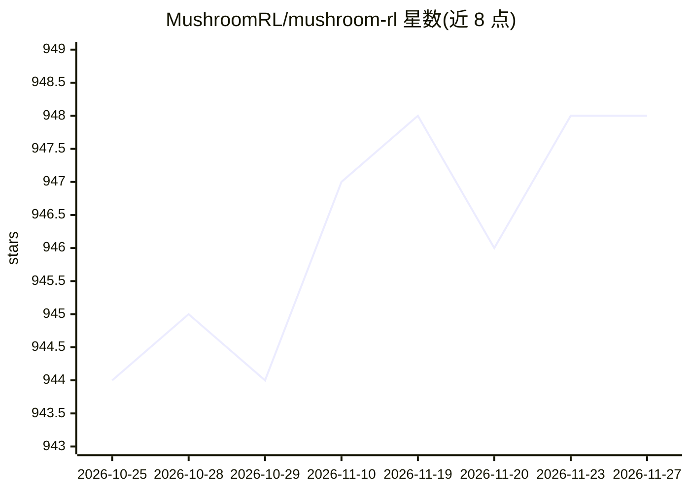

# MushroomRL/mushroom-rl

⭐ 948 · Python · MIT · 推送 2026-11-26 · [GitHub](https://github.com/MushroomRL/mushroom-rl) · 组织维护

**面向 RL 研究者的 Python 强化学习实验库**

MushroomRL 是模块化设计的 Python 强化学习库，用于搭建与运行 RL 实验；通过适配层接入 PyTorch、Tensorflow 等张量计算库，以及 Gymnasium、PyBullet、Deepmind Control Suite 等基准环境。内置经典算法（Q-Learning、SARSA、FQI）与深度 RL 算法（DQN、DDPG、SAC、TD3、TRPO、PPO）。实验通过脚本文件配置运行，examples 目录提供可执行示例；可选组件（Atari、物理模拟器、Isaac Sim）需通过 extras 安装。附 JMLR 论文引用条目。

## 筛选速览

| 维度 | 判定 | 备注 |
|---|---|---|
| AI 角色 | `ai-native` | 本体是模型或模型工具 |
| 许可风险 | `permissive` | MIT |
| 部署形态 | `library` | 以包/库形式分发 |
| 模型依赖 | — | README 未给出锁定关系 |
| 硬件要求 | — | 无带数字的原话,不猜 |
| 安装摩擦 | `medium` | 含编译或系统依赖之一 |
| 成熟度 | — | 结构信号不足 |

## 能力要点

- 内置经典 RL（Q-Learning/SARSA/FQI）与深度 RL（DQN/DDPG/SAC/TD3/TRPO/PPO）算法
- 对接 PyTorch/Tensorflow 与 Gymnasium/PyBullet/DM Control 基准环境
- pip extras 提供可选组件（Atari、MuJoCo、Isaac Sim）
- 提供文档、教程与论文复现示例脚本

## 适用场景

- 跑经典与深度 RL 算法对比实验
- 在 Gymnasium/MuJoCo 等基准环境上训练智能体
- 复现论文中的 RL 实验
- 科研中快速搭建新 RL 算法原型

## 场景标签

`强化学习` · 领域:训练与推理

## 证据(README 行号)

> L25: MushroomRL is a Python Reinforcement Learning (RL) library whose modularity allows
> L28: It allows to perform RL experiments in a simple way providing classical RL algorithms
> L29: (e.g. Q-Learning, SARSA, FQI), and deep RL algorithms (e.g. DQN, DDPG, SAC, TD3,

## 星数曲线

2026-10-25 944 → 2026-11-27 948（+4）

---
*卡片 v1 · prompt 1.4 · 生成 2026-11-24 · 置信度 high · 依据 README sha `2bc61568d693` · [字段定义](../../DATASET.md)*
