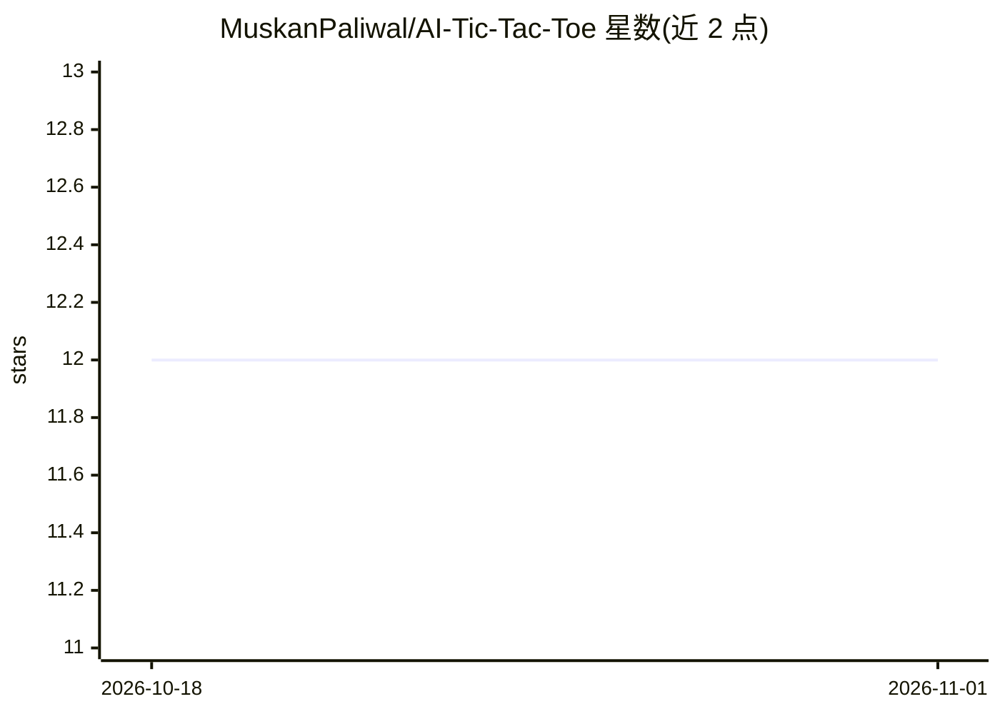

# MuskanPaliwal/AI-Tic-Tac-Toe

⭐ 12 · Python · MIT · 推送 2026-09-15 · [GitHub](https://github.com/MuskanPaliwal/AI-Tic-Tac-Toe) · 个人维护

**井字棋 AI 教学仓库：Minimax 与 SARSA/Q-learning 实现**

用 Python 实现的井字棋 AI 仓库，包含两部分：基于 Minimax 算法的博弈树搜索实现（README 逐步讲解伪代码与递归逻辑），以及强化学习部分——实现 SARSA 与 Q-learning 两种学习代理，可由用户手动对局训练，或由按概率 p 执行最优策略的教师代理自动训练。提供 play.py 命令行脚本，支持初始化、加载、继续训练代理及绘制累计奖励历史；仓库附带已训练 100000 局的 .pkl 代理文件。完整代码位于 py_version/ 与 tictactoe/ 目录。

## 筛选速览

| 维度 | 判定 | 备注 |
|---|---|---|
| AI 角色 | `ai-native` | 本体是模型或模型工具 |
| 许可风险 | `permissive` | MIT |
| 部署形态 | `None` |  |
| 模型依赖 | — | README 未给出锁定关系 |
| 硬件要求 | — | 无带数字的原话,不猜 |
| 安装摩擦 | `low` | 无编译、无系统依赖或容器化 |
| 成熟度 | — | 结构信号不足 |

## 能力要点

- Minimax 算法的逐步讲解与 Python 实现
- SARSA 与 Q-learning 两种强化学习代理实现
- 教师代理按概率 p 执行最优策略自动训练
- 附带训练 100000 局的 .pkl 代理文件与奖励历史绘图

## 适用场景

- 学习 Minimax 博弈树搜索算法的实现细节
- 通过人机对局训练 RL 代理玩井字棋
- 对比 SARSA 与 Q-learning 的 Q 值更新差异

## 场景标签

`教程课程` · 领域:学习与行业

## 证据(README 行号)

> L5: An implementation of Minimax AI Algorithm on Tic-Tac-Toe (or Noughts and Crosses) game.
> L123: AI agent to play Tic-tac-toe using

## 星数曲线

2026-10-18 12 → 2026-11-01 12（+0）

---
*卡片 v1 · prompt 1.4 · 生成 2026-11-01 · 置信度 high · 依据 README sha `6d36de2a1b45` · [字段定义](../../DATASET.md)*
