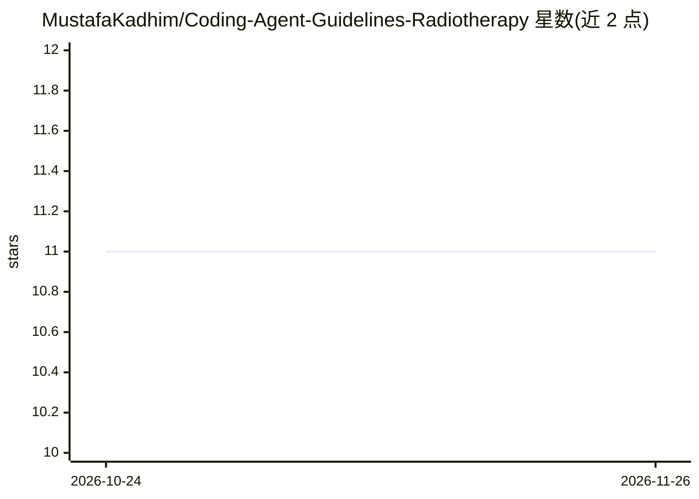

# MustafaKadhim/Coding-Agent-Guidelines-Radiotherapy

⭐ 11 · MIT · 推送 2026-04-28 · [GitHub](https://github.com/MustafaKadhim/Coding-Agent-Guidelines-Radiotherapy) · 个人维护

**面向放疗研究的编码 Agent 指令文件集合**

提供两份可直接复制到项目根目录的编码 Agent 指令文件：面向 Codex 类工具的 AGENTS.md 与面向 Claude Code 的 CLAUDE.md。内容针对放疗与医学影像研究代码的风险场景编写，涵盖患者级数据划分、DICOM/NIfTI 几何处理、掩膜与剂量网格插值、患者隐私保护、模型评估与临床声明约束等护栏条目，并给出编码 Agent 的六步工作流程。作者声明其非临床软件，不构成临床验证或监管文档。以 MIT 许可发布。

## 筛选速览

| 维度 | 判定 | 备注 |
|---|---|---|
| AI 角色 | `ai-knowledge` | 知识聚合/清单类 |
| 许可风险 | `permissive` | MIT |
| 部署形态 | `None` |  |
| 模型依赖 | — | README 未给出锁定关系 |
| 硬件要求 | — | 无带数字的原话,不猜 |
| 安装摩擦 | `low` | 无编译、无系统依赖或容器化 |
| 成熟度 | — | 结构信号不足 |

## 能力要点

- 提供 AGENTS.md（Codex 类工具）与 CLAUDE.md（Claude Code）两份指令文件
- 针对数据泄露、影像几何、插值、隐私日志等放疗研究风险给出护栏条目
- 覆盖 PyTorch、PyTorch Lightning、MONAI、TorchIO、SimpleITK、nibabel、pydicom 工作流语境
- MIT 许可，复制文件到项目根目录即可使用

## 适用场景

- 为放疗影像深度学习管线项目配置编码 Agent 的领域指令
- 让 AI 编码助手在修改预处理/训练代码时遵循患者级划分与几何约束
- 医学物理与放疗 AI 研究团队统一 Agent 编码规范

## 场景标签

`提示工程` · 领域:Agent 开发

## 证据(README 行号)

> L11: These are my personal coding guidelines optimized for radiotherapy research and inspired by Andrej Karpathy's work 
> L37: This repository provides domain-specific instructions to help coding agents work

## 星数曲线

2026-10-24 11 → 2026-11-26 11（+0）

---
*卡片 v1 · prompt 1.4 · 生成 2026-11-19 · 置信度 high · 依据 README sha `5935b58e0ce5` · [字段定义](../../DATASET.md)*
