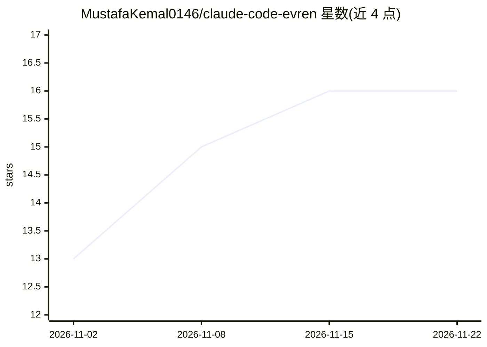

# MustafaKemal0146/claude-code-evren

⭐ 16 · Shell · MIT · 推送 2026-11-01 · [GitHub](https://github.com/MustafaKemal0146/claude-code-evren) · 个人维护 · 中文 README

**将 Claude Code 接入 EVREN 模型网关的安装与卸载脚本指南**

非官方社区指南，提供 install.sh / uninstall.sh 脚本与 evren 命令，通过设置 ANTHROPIC_BASE_URL / ANTHROPIC_AUTH_TOKEN / ANTHROPIC_MODEL 三个环境变量，把 Claude Code 的请求指向 EVREN 网关（Anthropic Messages API 兼容），从而调用 deepseek-v4.1-flash、glm-5.3 等开源模型。会话级隔离，不改动用户原有 claude 配置；支持卸载脚本清理。Linux 已验证，Windows（WSL/PowerShell）与 macOS 未验证。

## 筛选速览

| 维度 | 判定 | 备注 |
|---|---|---|
| AI 角色 | `ai-ecosystem` | LLM/agent 周边工具 |
| 许可风险 | `permissive` | MIT |
| 部署形态 | `None` |  |
| 模型依赖 | — | README 未给出锁定关系 |
| 硬件要求 | — | 无带数字的原话,不猜 |
| 安装摩擦 | `low` | 无编译、无系统依赖或容器化 |
| 成熟度 | `idea` | |

## 能力要点

- 单命令安装与卸载，bash/zrc 配置块可重复执行不重复添加
- 通过环境变量把 Claude Code 指向 Anthropic Messages API 兼容的 EVREN 网关
- 自动设置子代理模型变量（ANTHROPIC_DEFAULT_*、CLAUDE_CODE_SUBAGENT_MODEL）
- 卸载脚本带备份清理 ~/.claude/settings.json 中 EVREN 残留配置

## 适用场景

- 让 Claude Code 使用 EVREN 网关上的开源模型（deepseek/glm/qwen 等）
- 在保留自己 Anthropic 账号的同时按会话切换模型来源
- 一键安装并随时干净回滚网关接入配置

## 场景标签

`模型网关` · 领域:Agent 开发

## 证据(README 行号)

> L68: Claude Code, Anthropic Messages API'sini konuşur. EVREN geçidi de aynı API'yi (`POST /v1/messages`) uyguladığı için
> L72: |`ANTHROPIC_BASE_URL`|`https://evren-llmapi.ssyz.org.tr`|İstekler Anthropic yerine EVREN'e gider. Sonuna **`/v1` ya
> L76: Claude Code arka plan işleri ve alt ajanlar için ayrı model adları da kullanır. Bunlar tanımlanmazsa istekler Claud

## 星数曲线

2026-11-02 13 → 2026-11-22 16（+3）

---
*卡片 v1 · prompt 1.4 · 生成 2026-11-18 · 置信度 high · 依据 README sha `96b8eb0c96da` · [字段定义](../../DATASET.md)*
