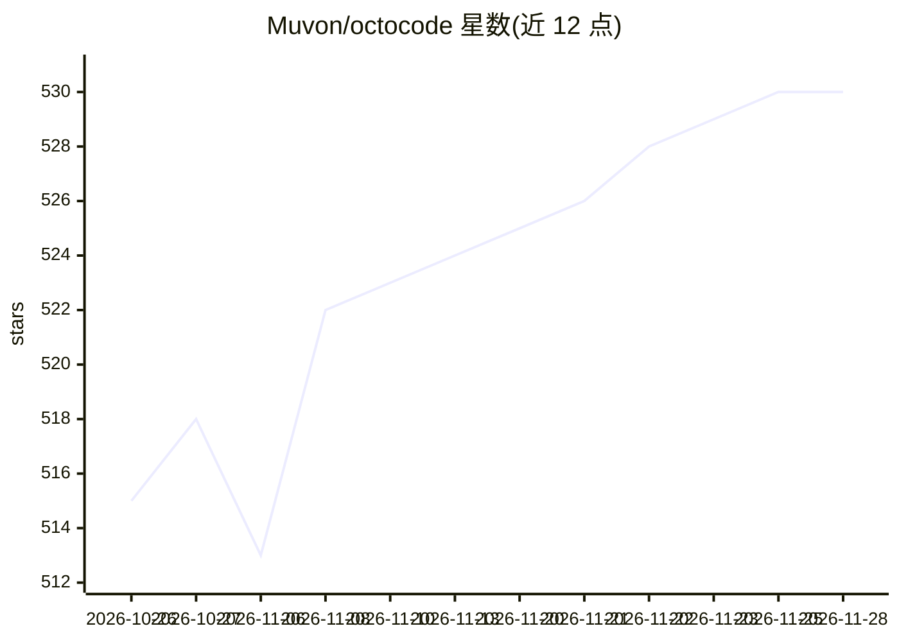

# Muvon/octocode

⭐ 530 · Rust · Apache-2.0 · 推送 2026-11-24 · [GitHub](https://github.com/Muvon/octocode) · [官网](https://octomind.run/product/octocode) · 组织维护

**面向 AI 编码助手的本地代码语义检索与依赖图 MCP 服务器**

以单个 Rust 二进制发布的 CLI 与 MCP 服务器，用于探索代码库：Tree-sitter 抽取符号与关系构建实时图，索引侧用本地 FastEmbed 嵌入加 BM25 做混合检索与重排，提供语义搜索、结构搜索、签名查看与 GraphRAG 工具。通过 stdio 接入 Claude Code、Codex、Cursor 等客户端，也可终端直接使用；支持 16 类语言的索引，默认本地运行无需 API key，远程 provider 为可选项。

## 筛选速览

| 维度 | 判定 | 备注 |
|---|---|---|
| AI 角色 | `ai-ecosystem` | LLM/agent 周边工具 |
| 许可风险 | `permissive` | Apache-2.0 |
| 部署形态 | `library` | 以包/库形式分发 |
| 模型依赖 | — | README 未给出锁定关系 |
| 硬件要求 | — | 无带数字的原话,不猜 |
| 安装摩擦 | `low` | 无编译、无系统依赖或容器化 |
| 成熟度 | — | 结构信号不足 |

## 能力要点

- 混合向量+关键词检索，可配置重排，默认本地模型无需 API key
- Tree-sitter 实时符号/依赖图，无需索引即可进行结构搜索与签名查看
- 内置 MCP 服务器，提供 semantic_search/structural_search/graphrag/lsp 等工具
- 与 OctoFS 配合时行 ID 可直接作为编辑目标，编辑前校验内容哈希

## 适用场景

- 让 Claude Code/Cursor 等客户端理解并检索我的代码库
- 按意图而非关键词查找代码与文档
- 追踪符号间的导入、调用、继承与实现关系
- 本地离线环境下做代码索引与搜索，不上传源码

## 场景标签

`知识图谱` `语义搜索` · 领域:知识与检索

## 证据(README 行号)

> L20: Octocode is a Rust CLI and MCP server for exploring codebases. It combines semantic search, structural search, and 
> L83: ## MCP integration
> L131: |Tool|Use it for|Requires an index|

## 星数曲线

2026-10-26 515 → 2026-11-28 530（+15）

---
*卡片 v1 · prompt 1.4 · 生成 2026-11-25 · 置信度 high · 依据 README sha `27a75e4dc17d` · [字段定义](../../DATASET.md)*
