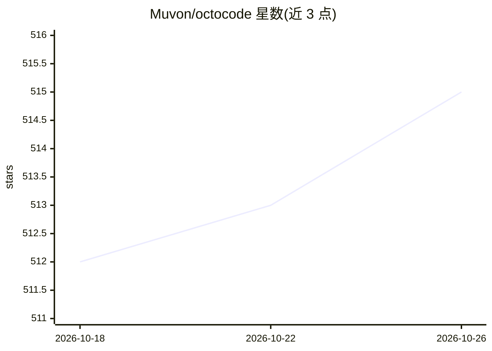

# Muvon/octocode

⭐ 515 · Rust · Apache-2.0 · 推送 2026-10-25 · [GitHub](https://github.com/Muvon/octocode) · [官网](https://octomind.run/product/octocode) · 个人维护

**给 AI agent 的代码库结构化检索工具：MCP 服务器+知识图谱+语义搜索**

用 Rust 编写的单一二进制工具，将项目转为可导航的知识图谱，供 Claude、Cursor、Windsurf 等 MCP 客户端的 AI 助手检索和理解代码库。核心机制：tree-sitter AST 解析构建文件/符号及其 imports、calls、extends、implements 关系的实时图谱，无需索引即可用；可选索引模式叠加语义文件匹配与 LLM 描述；混合检索（语义向量+BM25+重排序）；内置 MCP 服务器暴露 semantic_search、graphrag 等工具，LSP 工具需指定语言服务器启用。支持 17 种语言的 AST 解析。默认本地 fastembed 嵌入，无需 API key；云嵌入与 LLM 提供商为可选项。提供可复现检索基准（127 条代码查询）。

## 筛选速览

| 维度 | 判定 | 备注 |
|---|---|---|
| AI 角色 | `ai-ecosystem` | LLM/agent 周边工具 |
| 许可风险 | `permissive` | Apache-2.0 |
| 部署形态 | `library` | 以包/库形式分发 |
| 模型依赖 | — | README 未给出锁定关系 |
| 硬件要求 | — | 无带数字的原话,不猜 |
| 安装摩擦 | `low` | 无编译、无系统依赖或容器化 |
| 成熟度 | — | 结构信号不足 |

## 能力要点

- tree-sitter AST 构建实时符号/文件关系图谱，无需索引即可导航
- 内置 MCP 服务器暴露 semantic_search/graphrag/structural_search 等工具
- 混合检索：语义相似度 + BM25 全文 + 重排序
- 支持 17 种语言的 AST 解析，LSP 工具可选启用

## 适用场景

- 让 Claude/Cursor 等 AI 编程助手理解并导航我的代码库结构
- 用自然语言或 AST 模式在代码中做语义/结构化搜索
- 跨文件追踪导入、调用与依赖关系

## 场景标签

`知识图谱` `语义搜索` · 领域:知识与检索

## 证据(README 行号)

> L25: **The Solution:** Octocode's MCP server gives AI agents:
> L184: Octocode includes a **built-in MCP server** that exposes your codebase as tools to AI assistants. This is the prim
> L66: 5. **MCP Server** — exposes `semantic_search`, `view_signatures`, `graphrag`, and `structural_search` to any MCP-co

## 星数曲线

2026-10-18 512 → 2026-10-26 515（+3）

---
*卡片 v1 · prompt 1.4 · 生成 2026-10-21 · 置信度 high · 依据 README sha `2dad73cfc9b0` · [字段定义](../../DATASET.md)*
