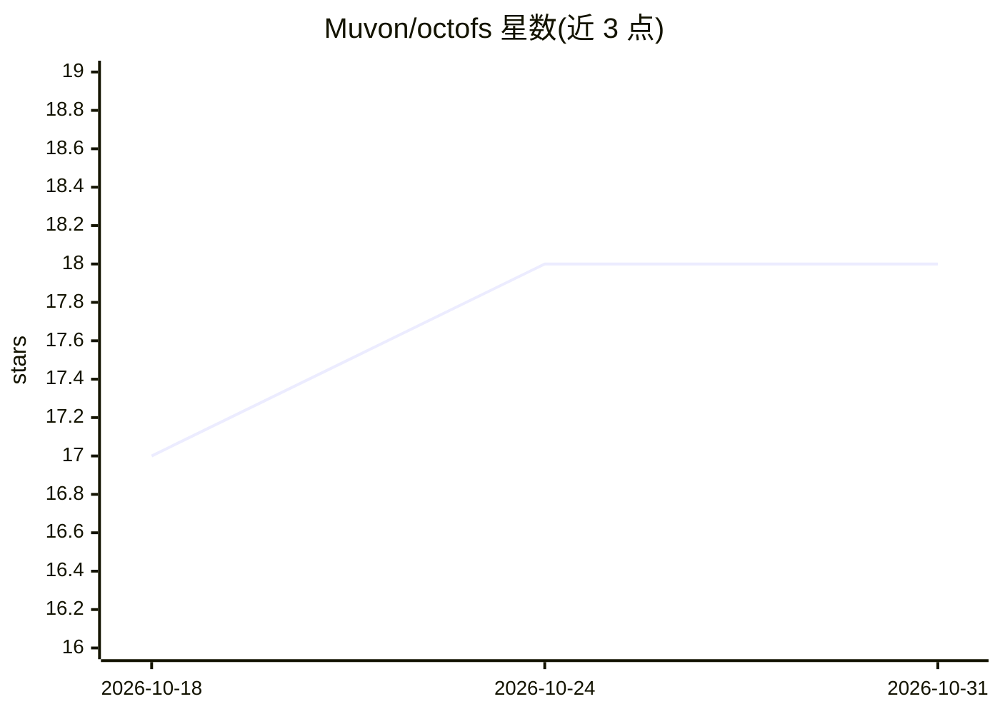

# Muvon/octofs

⭐ 18 · Rust · Apache-2.0 · 推送 2026-10-28 · [GitHub](https://github.com/Muvon/octofs) · [官网](https://octomind.run/product/octofs/) · 个人维护

**Rust 编写的 MCP 文件系统服务器，供 AI 编程代理读写编辑文件**

独立 Rust 二进制，通过 Model Context Protocol 向 AI 编程助手（Cursor、Claude Code、Codex、Windsurf 等）暴露文件系统工具：查看/搜索文件、创建编辑与原子化批量编辑、shell 执行与后台进程管理、工作目录上下文。关键机制为 N:hh 哈希校验行号，编辑前校验内容防止过期写入；所有文件工具透明支持 ssh:// URL 远程操作（不支持 RSA 密钥）。提供 cargo/brew/npm 预编译二进制与 .mcpb 安装包，支持 STDIO 与 HTTP 传输。

## 筛选速览

| 维度 | 判定 | 备注 |
|---|---|---|
| AI 角色 | `ai-ecosystem` | LLM/agent 周边工具 |
| 许可风险 | `permissive` | Apache-2.0 |
| 部署形态 | `library` | 以包/库形式分发 |
| 模型依赖 | — | README 未给出锁定关系 |
| 硬件要求 | — | 无带数字的原话,不猜 |
| 安装摩擦 | `medium` | 含编译或系统依赖之一 |
| 成熟度 | — | 结构信号不足 |

## 能力要点

- N:hh 复合行号（FNV-1a 哈希）在编辑时校验，过期写入报错并给出迁移提示
- 所有文件工具透明支持 SSH/SFTP（ssh:// URL），支持 OpenSSH 配置与密钥代理认证
- 检测 cat/grep/find/sed 等 shell 误用并拒绝执行，引导使用专用 MCP 工具
- 编译为单一 Rust 二进制，支持 STDIO 与带鉴权的 Streamable HTTP 传输

## 适用场景

- 为我的 AI 编程助手提供受控的文件读写与搜索能力
- 让 AI 代理通过 SSH/SFTP 直接操作远程服务器上的文件
- 在多客户端场景下通过 HTTP 远程挂载同一文件系统服务

## 场景标签

 · 领域:开发者工具/MCP 基础设施

## 证据(README 行号)

> L12: *Standalone Rust binary that exposes filesystem tools over the Model Context Protocol. Built on `rmcp` 3.x, `tokio`
> L20: Your AI coding assistant (Cursor, Claude, Windsurf, etc.) is smart — but it's **blind to your filesystem**. Octofs 

## 星数曲线

2026-10-18 17 → 2026-10-31 18（+1）

---
*卡片 v1 · prompt 1.4 · 生成 2026-10-29 · 置信度 high · 依据 README sha `d24a4955aaa6` · [字段定义](../../DATASET.md)*
