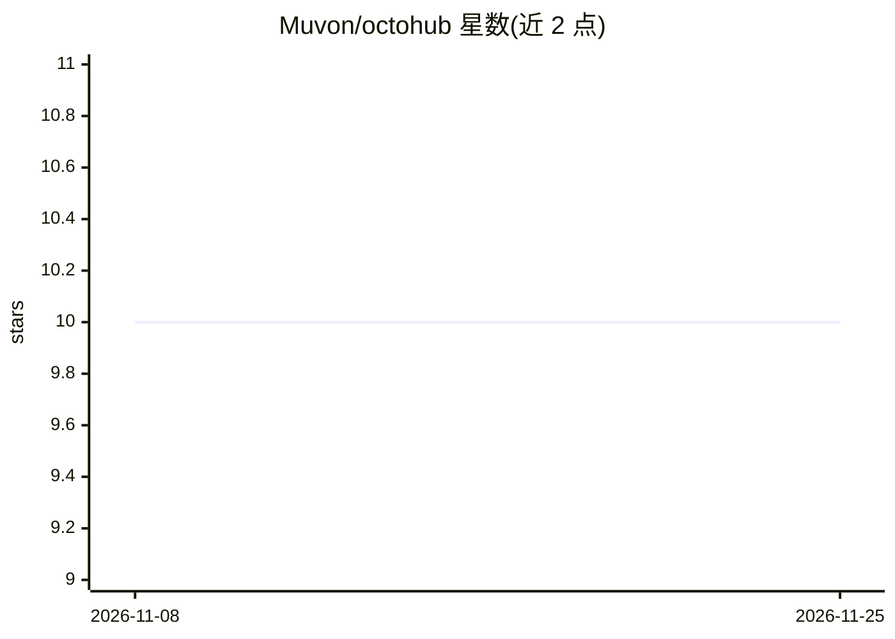

# Muvon/octohub

⭐ 10 · Rust · Apache-2.0 · 推送 2026-11-21 · [GitHub](https://github.com/Muvon/octohub) · [官网](https://octomind.run/product/octohub/) · 组织维护

**给团队的 LLM 代理网关：统一 OpenAI 风格 API 接入 20+ 上游**

Rust 编写的 LLM 代理，客户端连接单一稳定端点，由其路由到用户配置的 OpenAI、Anthropic、Google、DeepSeek、Ollama、OpenRouter、Modal 托管的 vLLM 等上游，并把每次请求与响应记录到自有数据库（SQLite/MySQL/PostgreSQL）。提供多租户 API key 与用量归属、模型映射与随机负载均衡、按上游并发限流、Prometheus 指标与请求 ID 关联，另支持图像/视频/语音/转录端点、SSE 流式与补全链式重放。面向需要按客户计量与审计日志的部署方。

## 筛选速览

| 维度 | 判定 | 备注 |
|---|---|---|
| AI 角色 | `ai-ecosystem` | LLM/agent 周边工具 |
| 许可风险 | `permissive` | Apache-2.0 |
| 部署形态 | `None` |  |
| 模型依赖 | local-ok | 支持本地模型 |
| 硬件要求 | — | 无带数字的原话,不猜 |
| 安装摩擦 | `medium` | 含编译或系统依赖之一 |
| 成熟度 | — | 结构信号不足 |

## 能力要点

- 一个 OpenAI 风格端点路由到 20+ 上游 provider
- 多租户 API key：签发/吊销、按 key 模型白名单与用量归属
- 请求/响应全量记录到 SQLite/MySQL/PostgreSQL，支持审计与重放
- 图像/视频/语音/转录端点与可续跑的媒体生成任务

## 适用场景

- 为多个客户发放独立 API key 并统计各自用量
- 在不改客户端代码的情况下更换或切换上游模型
- 留存完整请求日志用于审计与回放分析

## 场景标签

`模型网关` · 领域:Agent 开发

## 证据(README 行号)

> L9: OctoHub is a high-performance LLM proxy written in Rust. Clients talk to one
> L10: stable endpoint; OctoHub talks to whichever providers you configure — OpenAI,
> L89: - **Multi-tenant API keys** — issue/revoke per-client keys with per-key model

## 星数曲线

2026-11-08 10 → 2026-11-25 10（+0）

---
*卡片 v1 · prompt 1.4 · 生成 2026-11-20 · 置信度 high · 依据 README sha `1d384c6a0874` · [字段定义](../../DATASET.md)*
