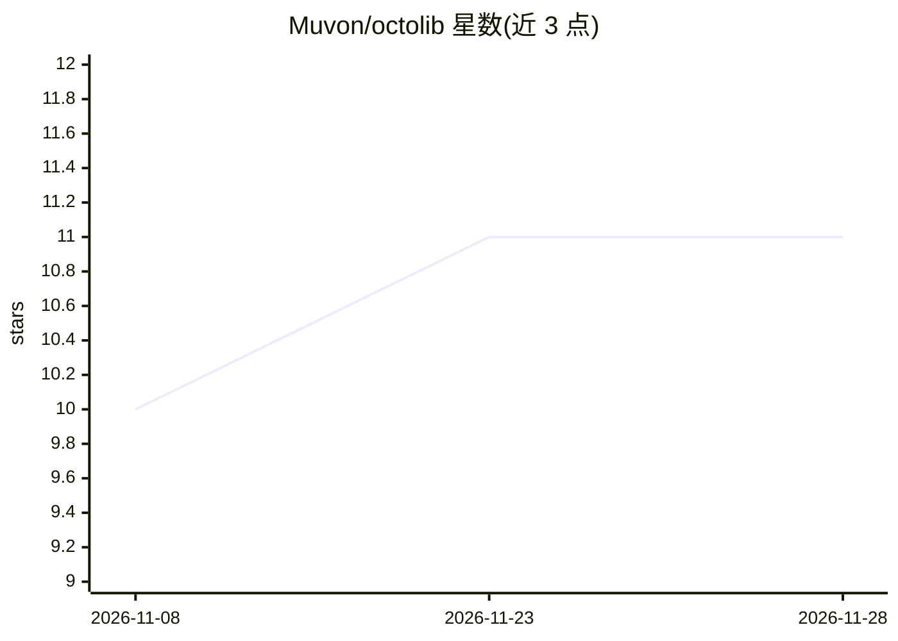

# Muvon/octolib

⭐ 11 · Rust · Apache-2.0 · 推送 2026-11-24 · [GitHub](https://github.com/Muvon/octolib) · [官网](https://octomind.run/product/octolib) · 个人维护

**统一接口接入 30+ AI 提供商的 Rust 库，内置成本追踪**

Octolib 是一个 Rust 库，通过 `provider:model` 字符串（如 `openai:gpt-4o`、`ollama:llama3.2`）经 `ProviderFactory` 解析到统一 `AiProvider` trait 背后的提供商，切换模型只改字符串。功能覆盖聊天补全、工具调用、结构化输出、嵌入、重排序、媒体生成与评估模型调用；crate 内置各模型定价表，每条响应报告 token 用量与美元成本。API 全程基于 `Result`，API key 仅从环境变量读取，通过 crates.io 或 git 依赖安装，功能模块可按需裁剪以减少编译时间。

## 筛选速览

| 维度 | 判定 | 备注 |
|---|---|---|
| AI 角色 | `ai-ecosystem` | LLM/agent 周边工具 |
| 许可风险 | `permissive` | Apache-2.0 |
| 部署形态 | `library` | 以包/库形式分发 |
| 模型依赖 | local-ok | 支持本地模型 |
| 硬件要求 | — | 无带数字的原话,不猜 |
| 安装摩擦 | `medium` | 含编译或系统依赖之一 |
| 成熟度 | — | 结构信号不足 |

## 能力要点

- 一个 `provider:model` 字符串统一寻址 33 个提供商
- 内置定价表，每条响应报告 token 与美元成本，零配置
- 工具调用、结构化输出、嵌入、重排序、媒体生成多能力模块可裁剪
- CLI 代理模式：以 `cli:<backend>/<model>` 驱动本地 CLI 作为提供商

## 适用场景

- 在 Rust 项目中以同一接口调用多家模型提供商
- 通过字符串切换模型而无需重写调用代码
- 需要按响应统计 token 与美元成本的应用
- 以本地 FastEmbed/HuggingFace 后端生成嵌入

## 场景标签

`模型网关` · 领域:Agent 开发

## 证据(README 行号)

> L11: Octolib is a self-sufficient Rust library for AI providers. One `provider:model` string — `openai:gpt-4o`, `anthrop
> L19: - **🔌 33 providers, one interface** — OpenAI, Anthropic, xAI, OpenRouter, Google Vertex & Studio, Amazon Bedrock, D
> L30: ## 📦 Quick Installation

## 星数曲线

2026-11-08 10 → 2026-11-28 11（+1）

---
*卡片 v1 · prompt 1.4 · 生成 2026-11-20 · 置信度 high · 依据 README sha `d958d774fd33` · [字段定义](../../DATASET.md)*
