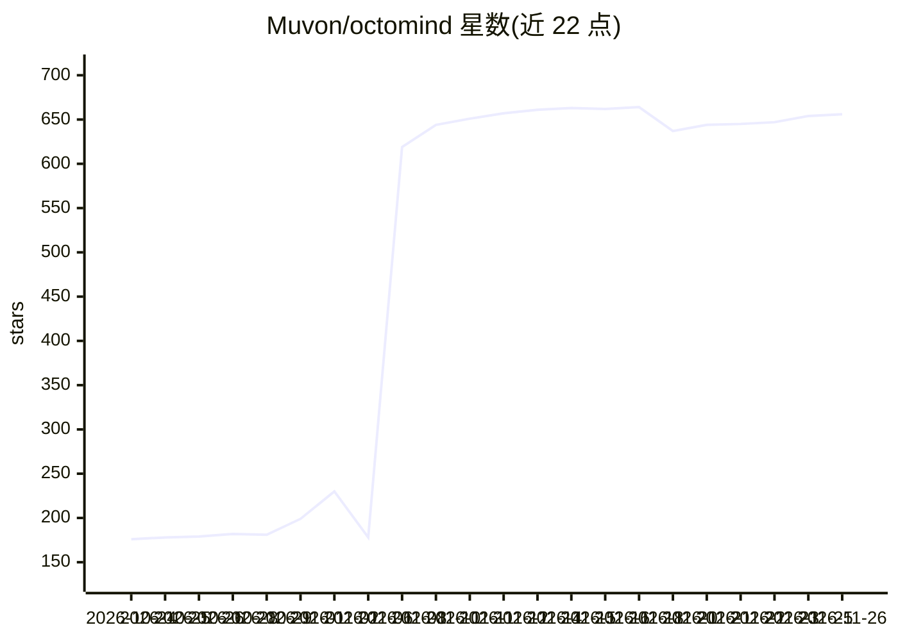

# Muvon/octomind

⭐ 656 · Rust · Apache-2.0 · 推送 2026-11-25 · [GitHub](https://github.com/Muvon/octomind) · [官网](https://octomind.run) · 个人维护

**开源编码 agent 运行时：单一 Rust 二进制，任意模型，MCP 原生**

Octomind 是一个开源 coding agent harness：通过 MCP 给任意 LLM 提供读写文件、运行 shell、搜索代码、委派子 agent 等工具，并以交互 CLI、stdin 管道、daemon、WebSocket、ACP 编辑器集成五种形态运行同一会话。策略以 TOML guardrails 形式落盘（pre-call guards、post-result hooks、post-turn validators），以确定性脚本替代逐步人工审批，使无人在场时可在 CI/daemon 中运行；可选 Besydr 插件负责任务规划、完成度核验与经验教训沉淀。支持按角色选模型、按请求/会话设预算上限，附基于 25 个已合并 PR 任务的基准结果与复现指南。

## 筛选速览

| 维度 | 判定 | 备注 |
|---|---|---|
| AI 角色 | `ai-ecosystem` | LLM/agent 周边工具 |
| 许可风险 | `permissive` | Apache-2.0 |
| 部署形态 | `self-host` | docker 或自建部署 |
| 模型依赖 | local-ok | 支持本地模型 |
| 硬件要求 | — | 无带数字的原话,不猜 |
| 安装摩擦 | `low` | 无编译、无系统依赖或容器化 |
| 成熟度 | — | 结构信号不足 |

## 能力要点

- 一个 Rust 二进制覆盖 CLI/stdin/daemon/WebSocket/ACP 五种运行形态
- TOML guardrails 实现策略即代码，无需人工审批弹窗即可在 CI/daemon 运行
- MCP 客户端支持 stdio/Streamable HTTP 与 OAuth，会话中可启停服务器
- tap 系统分发打包好的专项 agent（prompt、模型、MCP 服务器、权限）

## 适用场景

- 在终端或 CI 中让 agent 自主完成代码修改与修复测试
- 在 Zed、JetBrains、VS Code 等编辑器内通过 ACP 嵌入 agent
- 按预算约束运行无人值守的后台 agent（daemon/定时任务）
- 打包并分发团队自有的专项 agent 与工具集

## 场景标签

`编码 Agent` · 领域:编码与开发

## 证据(README 行号)

> L16: Octomind is an open-source coding agent harness. It gives any LLM the tools to work in a repository — read and edit
> L40: - **Any model, any budget.** Use Octomind Cloud or your own key (OpenRouter, Anthropic, OpenAI, DeepSeek, Ollama, a
> L154: |**MCP client**|stdio and Streamable HTTP servers, with OAuth; enable/disable servers mid-session|MCP tools|

## 星数曲线

2026-10-24 176 → 2026-11-26 656（+480）

---
*卡片 v1 · prompt 1.4 · 生成 2026-11-25 · 置信度 mid · 依据 README sha `63453d0d8942` · [字段定义](../../DATASET.md)*
