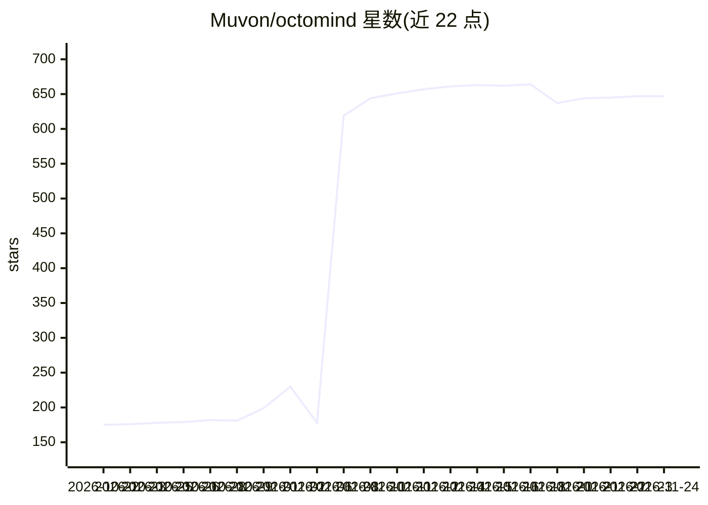

# Muvon/octomind

⭐ 647 · Rust · Apache-2.0 · 推送 2026-11-22 · [GitHub](https://github.com/Muvon/octomind) · [官网](https://octomind.run) · 个人维护

**开源编码 agent 运行时：单二进制接入任意模型，TOML 策略护栏**

用 Rust 编写的开源编码 agent harness：通过 MCP 为任意 LLM 提供读写文件、执行 shell、搜索代码、委派子 agent 等仓库内工具，并以交互 CLI、stdin 管道、daemon、WebSocket、ACP 五种形态运行于终端、CI 或编辑器。关键机制包括 TOML 护栏（guards/hooks/validators）、监督模型规划与核验完成声明、会话压缩与逐项目 lesson 学习、可经 shadow/A/B 试用演化为技能候选。安装覆盖 macOS/Linux 脚本、Windows PowerShell、Homebrew 与 crates.io。

## 筛选速览

| 维度 | 判定 | 备注 |
|---|---|---|
| AI 角色 | `ai-ecosystem` | LLM/agent 周边工具 |
| 许可风险 | `permissive` | Apache-2.0 |
| 部署形态 | `self-host` | docker 或自建部署 |
| 模型依赖 | local-ok | 支持本地模型 |
| 硬件要求 | — | 无带数字的原话,不猜 |
| 安装摩擦 | `low` | 无编译、无系统依赖或容器化 |
| 成熟度 | — | 结构信号不足 |

## 能力要点

- 单一 Rust 二进制支持交互 CLI/stdin/daemon/WebSocket/ACP 五种运行形态
- TOML 护栏实现策略即代码：pre-call guards、结果 hooks、turn validators
- 监督模型规划、核验完成证据；lesson 学习支持 shadow 与 A/B 试用演化
- MCP 客户端支持 stdio/Streamable HTTP 与 OAuth，技能走标准 SKILL.md

## 适用场景

- 在 CI 或无人值守场景中运行自动化代码修复任务
- 在 Zed/JetBrains/VS Code/Neovim 等编辑器内接入 ACP agent
- 按角色配置不同模型并设每请求/每会话预算上限
- 用护栏脚本替代人工审批弹窗实现自主 agent 循环

## 场景标签

`编码 Agent` · 领域:编码与开发

## 证据(README 行号)

> L16: Octomind is an open-source coding agent harness. It gives any LLM the tools to work in a repository — read and edit
> L40: - **Any model, any budget.** Use Octomind Cloud or your own key (OpenRouter, Anthropic, OpenAI, DeepSeek, Ollama, a

## 星数曲线

2026-10-22 175 → 2026-11-24 647（+472）

---
*卡片 v1 · prompt 1.4 · 生成 2026-11-24 · 置信度 high · 依据 README sha `1d7d1d14542c` · [字段定义](../../DATASET.md)*
