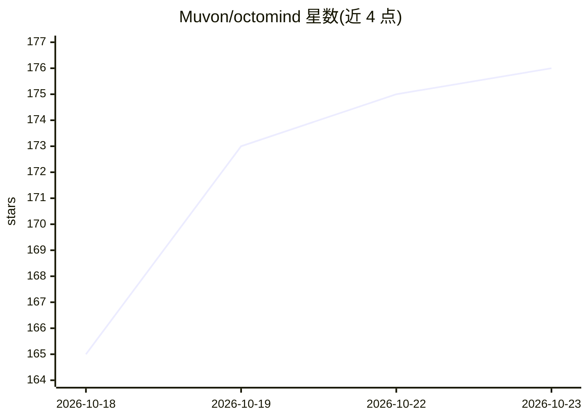

# Muvon/octomind

⭐ 176 · Rust · Apache-2.0 · 推送 2026-10-22 · [GitHub](https://github.com/Muvon/octomind) · [官网](https://octomind.run) · 组织维护

**面向自主运行的 CLI 优先 AI 编码 agent 运行时**

单二进制的 CLI 优先 AI 编码 agent 运行时：LLM 通过 MCP 工具获得仓库访问能力（读写文件、执行 shell、代码搜索、委派子 agent）。同一会话引擎支持交互 CLI、stdin 管道、后台守护进程、WebSocket 与 ACP 子 agent 五种运行面。模型可用 Octomind Cloud 或自带 key（OpenRouter/Anthropic/OpenAI/DeepSeek/Ollama 等）。以 TOML 声明 guardrails、角色、预算与工作流；通过 tap 注册表分发打包好的专家 agent。Rust 实现，提供安装脚本、Homebrew、Cargo、Docker 等多种安装方式。

## 筛选速览

| 维度 | 判定 | 备注 |
|---|---|---|
| AI 角色 | `ai-native` | 本体是模型或模型工具 |
| 许可风险 | `permissive` | Apache-2.0 |
| 部署形态 | `self-host` | docker 或自建部署 |
| 模型依赖 | local-ok | 支持本地模型 |
| 硬件要求 | — | 无带数字的原话,不猜 |
| 安装摩擦 | `low` | 无编译、无系统依赖或容器化 |
| 成熟度 | — | 结构信号不足 |

## 能力要点

- 单二进制，同一会话引擎支持交互/管道/守护进程/WebSocket/ACP 五种运行面
- TOML 声明式 guardrails（pre-call guards、hooks、post-turn validators）
- tap 注册表分发含模型、提示词、MCP 服务器与权限的专家 agent
- 按角色选模型并限制每请求/每会话开销

## 适用场景

- 在 CI 或定时任务中让 agent 自主处理编码任务
- 在终端日常开发中与 agent 协作修改代码
- 以守护进程或 ACP 子 agent 形式嵌入其他 agent 技术栈

## 场景标签

`编码 Agent` `Agent 框架` · 领域:Agent 开发

## 证据(README 行号)

> L18: Octomind is a CLI-first AI coding agent runtime. It gives an LLM real access to your repo — reading and writing fil
> L35: - **Any model, any budget.** Use Octomind Cloud or your own key (OpenRouter, Anthropic, OpenAI, DeepSeek, Ollama, a

## 星数曲线

2026-10-18 165 → 2026-10-23 176（+11）

---
*卡片 v1 · prompt 1.4 · 生成 2026-10-22 · 置信度 high · 依据 README sha `0992dffd716f` · [字段定义](../../DATASET.md)*
