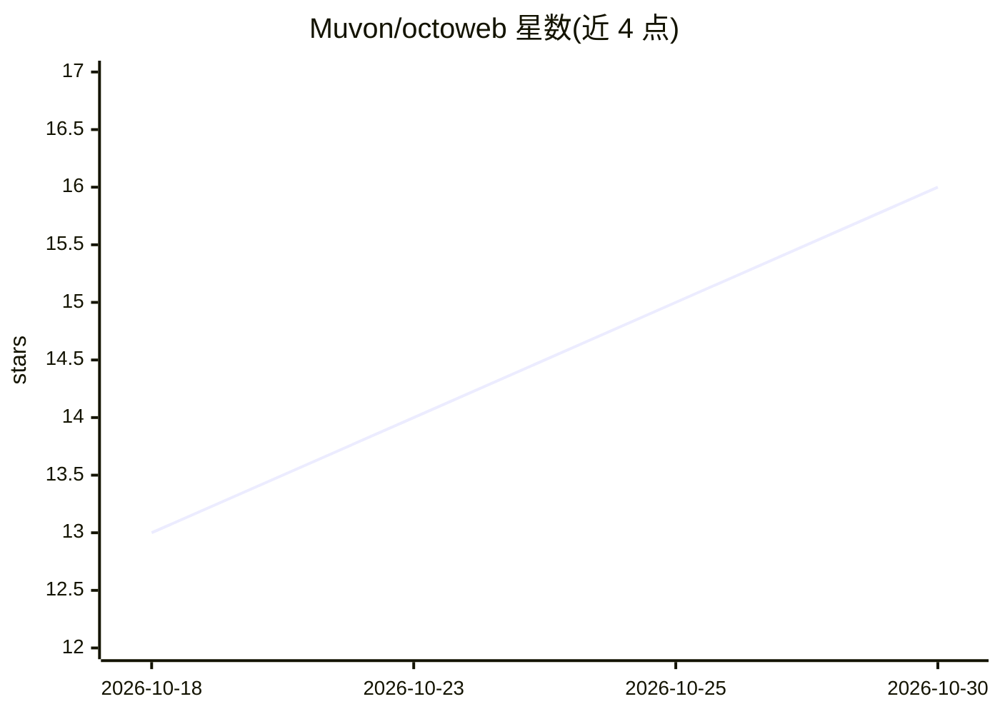

# Muvon/octoweb

⭐ 16 · Rust · Apache-2.0 · 推送 2026-10-27 · [GitHub](https://github.com/Muvon/octoweb) · [官网](https://octoweb.xyz) · 个人维护

**macOS 键盘优先的 AI 浏览器：内置 AI 助手侧栏与 MCP 服务器**

基于 WebKit 与 Rust 构建的 macOS 专用浏览器，不使用 Electron 或 Chrome。核是键盘驱动操作：命令面板、快速访问槽位、隔离工作区（独立 cookies/历史/AI 会话）、页面内文本搜索、邮件/日历/笔记/终端等面板。AI 能力包括：由本地 octomind agent 服务器驱动的侧栏助手（需单独安装并配置 API key）、行内 AI 文本变换、默认关闭的后台浏览模式学习，以及暴露 44 个工具的 MCP 服务器，让 Claude Desktop 等 MCP 客户端直接控制浏览器。支持 A2UI v1.0 渲染 agent 生成的交互界面。

## 筛选速览

| 维度 | 判定 | 备注 |
|---|---|---|
| AI 角色 | `ai-enhanced` | 去掉 AI 部分产品仍成立 |
| 许可风险 | `permissive` | Apache-2.0 |
| 部署形态 | `None` |  |
| 模型依赖 | locked-api |  |
| 硬件要求 | — | 无带数字的原话,不猜 |
| 安装摩擦 | `low` | 无编译、无系统依赖或容器化 |
| 成熟度 | — | 结构信号不足 |

## 能力要点

- 内置 MCP 服务器（localhost:3434/mcp）暴露 44 个浏览器控制工具
- AI 侧栏由本地 octomind agent 运行时驱动，支持自定义 agent 标签
- 隔离工作区：独立 tabs/历史/AI 会话与 WebKit 数据存储
- 支持 A2UI v1.0，agent 可渲染表单/按钮等交互界面

## 适用场景

- 用键盘快捷键和命令面板高效浏览与管理标签页
- 在侧栏向 AI 助手询问当前页面内容或改写选中文本
- 让 Claude Desktop 等 MCP 客户端直接驱动浏览器完成自动化任务
- 用隔离工作区分离不同账号与浏览场景

## 场景标签

`浏览器自动化` `AI 助手` · 领域:效率与自动化

## 证据(README 行号)

> L23: 2. **AI assistant built in** — Not an extension, not a tab. A sidebar overlay powered by a local octomind agent ser
> L25: 3. **MCP server inside the browser** — Your AI tools can actually *drive* the browser. Octoweb runs an MCP server o
> L39: - **AI sidebar** (`⌘⇧A`) — Chat with a local AI agent about the current page. Streaming responses, code blocks with

## 星数曲线

2026-10-18 13 → 2026-10-30 16（+3）

---
*卡片 v1 · prompt 1.4 · 生成 2026-10-30 · 置信度 high · 依据 README sha `be07fc0ae527` · [字段定义](../../DATASET.md)*
