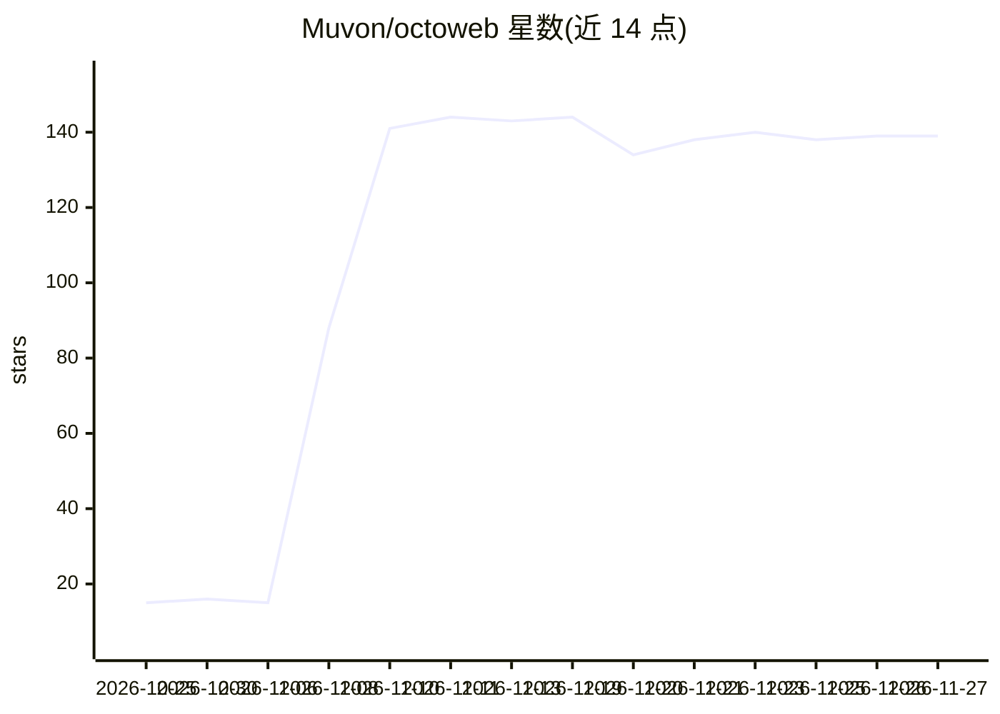

# Muvon/octoweb

⭐ 139 · Rust · Apache-2.0 · 推送 2026-11-21 · [GitHub](https://github.com/Muvon/octoweb) · [官网](https://octoweb.xyz) · 个人维护

**macOS 键盘优先 AI 浏览器：侧边栏助手加 MCP 控制接口**

基于 WebKit 与 Rust 构建的 macOS 浏览器，围绕键盘操作设计：命令面板、页内全文记忆搜索、私有标签、隔离工作区、阅读队列、邮件/日历/任务/终端面板等。AI 部分包括侧边栏聊天、选中文本 AI 改写、默认关闭的后台学习代理；AI 能力通过本地 octomind agent 服务器提供，需用户自行安装 octomind 并配置 API key。浏览器内建 MCP 服务器（localhost:3434/mcp），暴露 44 个工具供 Claude Desktop 等 MCP 客户端直接控制浏览器，并支持 A2UI v1.0 渲染 agent 生成的交互界面。

## 筛选速览

| 维度 | 判定 | 备注 |
|---|---|---|
| AI 角色 | `ai-enhanced` | 去掉 AI 部分产品仍成立 |
| 许可风险 | `permissive` | Apache-2.0 |
| 部署形态 | `None` |  |
| 模型依赖 | — | README 未给出锁定关系 |
| 硬件要求 | — | 无带数字的原话,不猜 |
| 安装摩擦 | `low` | 无编译、无系统依赖或容器化 |
| 成熟度 | — | 结构信号不足 |

## 能力要点

- 内建 MCP 服务器，暴露 44 个工具供 AI 客户端控制浏览器
- 侧边栏 AI 助手通过本地 octomind 服务器以 WebSocket 连接
- 键盘快捷键覆盖全部操作，支持自定义重映射
- 工作区隔离：独立的标签、历史、AI 会话与 WebKit 数据存储

## 适用场景

- 在浏览网页时用侧边栏助手总结或解释当前页面
- 让 Claude Desktop 等 MCP 客户端直接驱动浏览器完成自动化操作
- 用隔离工作区管理多账号的邮件、日历与浏览会话

## 场景标签

`浏览器自动化` `AI 助手` · 领域:效率与自动化

## 证据(README 行号)

> L7: **The browser you reach for when you want to think. macOS only, by design.**
> L23: 2. **AI assistant built in** — Not an extension, not a tab. A sidebar overlay powered by a local octomind agent ser
> L25: 3. **MCP server inside the browser** — Your AI tools can actually *drive* the browser. Octoweb runs an MCP server o

## 星数曲线

2026-10-25 15 → 2026-11-27 139（+124）

---
*卡片 v1 · prompt 1.4 · 生成 2026-11-27 · 置信度 high · 依据 README sha `bccd9fe57391` · [字段定义](../../DATASET.md)*
