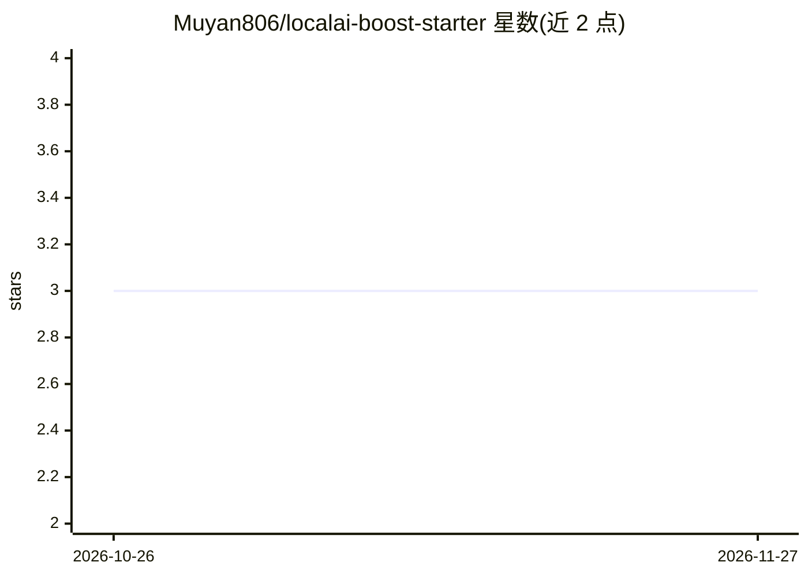

# Muyan806/localai-boost-starter

⭐ 3 · Batchfile · 推送 2026-10-25 · [GitHub](https://github.com/Muyan806/localai-boost-starter) · [官网](https://localaiboost.gumroad.com/l/free) · 个人维护

**为本地 7B–14B 模型提供调优系统提示与推理参数的预设包**

面向 Ollama、LM Studio、Open WebUI 与 llama.cpp CLI 四种本地运行方式的提示词预设包，免费版含 4 个调优引擎（编码、自动化脚本、头脑风暴、角色构建），每个预设包含系统提示、temperature/top_p/repeat_penalty 参数与 8192 上下文设置，附带 Windows/Mac/Linux 一键安装脚本与 llama-cli 命令行参数。基础模型默认为 llama3.1:8b，可编辑 Modelfile 更换。PRO 版提供 20 个引擎与参数手册，在 Gumroad 付费销售。

## 筛选速览

| 维度 | 判定 | 备注 |
|---|---|---|
| AI 角色 | `ai-ecosystem` | LLM/agent 周边工具 |
| 许可风险 | `none` | — |
| 部署形态 | `self-host` | docker 或自建部署 |
| 模型依赖 | local-ok | 支持本地模型 |
| 硬件要求 | — | 无带数字的原话,不猜 |
| 安装摩擦 | `low` | 无编译、无系统依赖或容器化 |
| 成熟度 | `idea` | |

## 能力要点

- 4 个免费预设引擎，覆盖编码/自动化/创意场景
- 每预设含校准的 repeat_penalty 与 8192 上下文参数
- 支持 Ollama/LM Studio/Open WebUI/llama.cpp 四种接入方式
- 提供 Windows 与 Mac/Linux 一键安装脚本

## 适用场景

- 让本地 7B–14B 模型直接输出可用代码块而不带冗余客套
- 解决本地模型重复循环或语法破碎的输出问题
- 在 LM Studio/Open WebUI 中一键配置调优好的系统提示
- 用本地模型批量生成 Windows/PowerShell/Bash 自动化脚本

## 场景标签

`提示工程` · 领域:Agent 开发

## 证据(README 行号)

> L2: > **Turn Generic Local Models into High-Performance Specialty AI Tools**
> L3: > Tailored for **Ollama**, **LM Studio**, **Open WebUI**, and **llama.cpp (CLI)**.
> L16: **LocalAI Boost Pack** fixes this immediately with battle-tested system prompts featuring strict **Negative Constra

## 星数曲线

2026-10-26 3 → 2026-11-27 3（+0）

---
*卡片 v1 · prompt 1.4 · 生成 2026-11-22 · 置信度 mid · 依据 README sha `3a305e3c81d0` · [字段定义](../../DATASET.md)*
