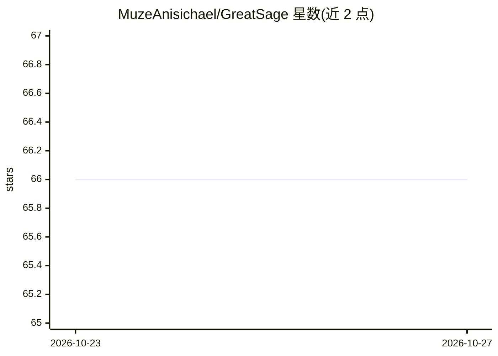

# MuzeAnisichael/GreatSage

⭐ 66 · Python · MIT · 推送 2026-10-23 · [GitHub](https://github.com/MuzeAnisichael/GreatSage) · 个人维护 · 中文 README

**Windows 桌面语音秘书：听写、跨会话记忆、生成带出处纪要**

面向 Windows 11 用户的 Electron+Python 桌面语音助手：同时监听麦克风与桌面音源，跨会话保留带来源的原文、记忆与三层摘要；可将会议与导入的 Markdown 资料整理成逐条标注来源的纪要、待办和文档草稿；写入/打开/删除等有副作用的操作默认需控制台确认。语音识别、语言模型与语音合成可分别配置 OpenRouter、OpenAI 兼容接口或 Ollama 本地方案，每次交互带 trace ID 可审计。项目处于 alpha 阶段，提供 Windows x64 ZIP 与实验性 NSIS 安装器。

## 筛选速览

| 维度 | 判定 | 备注 |
|---|---|---|
| AI 角色 | `ai-native` | 本体是模型或模型工具 |
| 许可风险 | `permissive` | MIT |
| 部署形态 | `desktop` | 安装包/桌面程序 |
| 模型依赖 | local-ok | 支持本地模型 |
| 硬件要求 | — | 无带数字的原话,不猜 |
| 安装摩擦 | `low` | 无编译、无系统依赖或容器化 |
| 成熟度 | `idea` | |

## 能力要点

- 麦克风+桌面音源同时监听，三种预设角色决定响应行为
- 跨会话记忆全部保留来源，修正原文可令派生内容一并失效
- 纪要逐条标注来源标记，无来源条目明确标出
- 写入/删除操作先确认且可撤销，请求快照默认只存元数据

## 适用场景

- 旁听线上会议并自动生成可核对的纪要与待办
- 让桌面助手记住跨会话的事实并随时检索
- 用云端或本地模型搭配完成语音对话与播报

## 场景标签

`语音 Agent` `AI 助手` · 领域:对话与助手

## 证据(README 行号)

> L5: **会听、会记、会动手的 Windows 桌面秘书**
> L7: 听你说话，也能旁听电脑里的会议声音；跨会话记住事实，把会议和资料整理成带出处的纪要、待办和文档。有副作用的操作，先等你确认。
> L49:  - 语音识别、语言模型和语音合成可以分别配置，混用 OpenRouter、OpenAI 兼容接口、Ollama 和本地方案。

## 星数曲线

2026-10-23 66 → 2026-10-27 66（+0）

---
*卡片 v1 · prompt 1.4 · 生成 2026-10-24 · 置信度 high · 依据 README sha `039504777262` · [字段定义](../../DATASET.md)*
