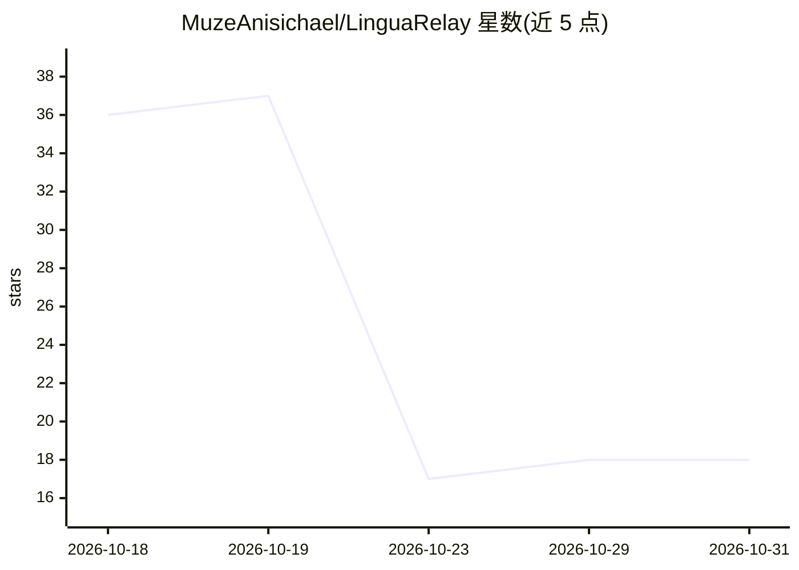

# MuzeAnisichael/LinguaRelay

⭐ 18 · Python · MIT · 推送 2026-10-06 · [GitHub](https://github.com/MuzeAnisichael/LinguaRelay) · [官网](https://github.com/MuzeAnisichael/LinguaRelay/releases/latest) · 个人维护 · 中文 README

**Windows 实时系统音频翻译字幕工具，支持中日英韩 12 路线**

Windows 桌面应用：通过 WASAPI 捕获系统输出、指定进程或麦克风音频，用 faster-whisper 做流式语音识别，M2M100/CTranslate2 本地翻译，在置顶悬浮窗显示字幕；也可录制或导入音视频，在离线工作台重跑 ASR、编辑并导出多种字幕格式。中/日/英/韩 12 条语言路线全支持，源语言手动指定。模型推理默认本地，可选接入 OpenAI 兼容端点对已完成字幕做 LLM 修订；当前为 v0.3.2 alpha，仅支持 Windows 10/11 x64。

## 筛选速览

| 维度 | 判定 | 备注 |
|---|---|---|
| AI 角色 | `ai-native` | 本体是模型或模型工具 |
| 许可风险 | `permissive` | MIT |
| 部署形态 | `desktop` | 安装包/桌面程序 |
| 模型依赖 | local-ok | 支持本地模型 |
| 硬件要求 | — | 无带数字的原话,不猜 |
| 安装摩擦 | `low` | 无编译、无系统依赖或容器化 |
| 成熟度 | `idea` | |

## 能力要点

- 三种音频来源捕获（全系统输出/指定进程/麦克风）
- 本地 faster-whisper + M2M100 完成 12 条语言路线的识别与翻译
- 离线工作台支持重跑 ASR、编辑字幕并导出 WebVTT/SRT/ASS 等格式
- 可选 LLM 修订：支持本地 OpenAI 兼容服务器（Ollama/LM Studio）与 HTTPS API

## 适用场景

- 看外语视频或参加外语会议时显示实时翻译字幕
- 为录音或视频文件生成可编辑的时间对齐字幕
- 只想翻译某个应用的声音而不捕获整个系统音频

## 场景标签

`语音识别` · 领域:感知与多模态

## 证据(README 行号)

> L23: LinguaRelay listens to Windows system output, a selected process, or a microphone, recognizes speech, and
> L111: - Stream multilingual `faster-whisper` partials, show recognized text before the
> L114: - Translate all 12 routes locally with one warmed M2M100/CTranslate2 model.

## 星数曲线

2026-10-18 36 → 2026-10-31 18（-18）

---
*卡片 v1 · prompt 1.4 · 生成 2026-10-29 · 置信度 high · 依据 README sha `77a86f2d469b` · [字段定义](../../DATASET.md)*
