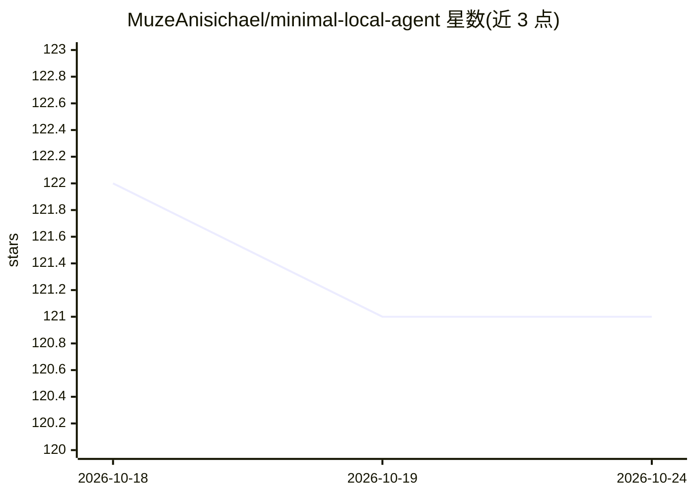

# MuzeAnisichael/minimal-local-agent

⭐ 121 · Python · MIT · 推送 2026-10-12 · [GitHub](https://github.com/MuzeAnisichael/minimal-local-agent) · [官网](https://github.com/MuzeAnisichael/minimal-local-agent/tree/main/docs#readme) · 个人维护 · 中文 README

**本地优先的小型 agent 内核：受限工具、可撤销编辑、可审计运行**

面向想理解、嵌入和定制 agent 的开发者，提供一个单模型/单工具循环的本地 agent 内核：限定单一 workspace，权限被拒的工具从模型 schema 中移除；文件写入需经 diff 预览与批准，支持多文件事务、回滚与哈希校验的撤销；运行历史、工具审计与哈希链式执行回执存于本地 SQLite。可经 CLI、回环本地 Web 控制台或 Python 宿主使用，接入 Ollama 或显式配置的 Chat Completions 兼容 API。模型/工具迭代由 PydanticAI 承担。限制：单一活动任务、无内建 shell/浏览器控制，v1.1.0 尚未发布。

## 筛选速览

| 维度 | 判定 | 备注 |
|---|---|---|
| AI 角色 | `ai-ecosystem` | LLM/agent 周边工具 |
| 许可风险 | `permissive` | MIT |
| 部署形态 | `library` | 以包/库形式分发 |
| 模型依赖 | local-ok | 支持本地模型 |
| 硬件要求 | — | 无带数字的原话,不猜 |
| 安装摩擦 | `low` | 无编译、无系统依赖或容器化 |
| 成熟度 | — | 结构信号不足 |

## 能力要点

- 权限即工具面：被拒工具从模型 schema 移除而非依赖提示词
- 受限 diff + 批准 + 事务回滚 + 哈希校验撤销的可审编辑
- SQLite 存储会话、历史、审计与哈希链式执行回执
- 可选的限定范围记忆、咨询式规划、显式 peers 与只读实时检查器（默认关闭）

## 适用场景

- 在本地以受控方式让 agent 读写指定 workspace 文件
- 研究并定制一个代码量小、边界明确的 agent 内核
- 需要留痕审计与可撤销文件修改的自动化任务

## 场景标签

`Agent 框架` · 领域:Agent 开发

## 证据(README 行号)

> L15: One model/tool loop, one bounded workspace, and a local SQLite record of what
> L24: Built for developers who want to understand, embed, and customize an agent—not
> L157: PydanticAI handles model/tool iteration; project code handles boundaries,

## 星数曲线

2026-10-18 122 → 2026-10-24 121（-1）

---
*卡片 v1 · prompt 1.4 · 生成 2026-10-23 · 置信度 mid · 依据 README sha `1ef7aa50f150` · [字段定义](../../DATASET.md)*
