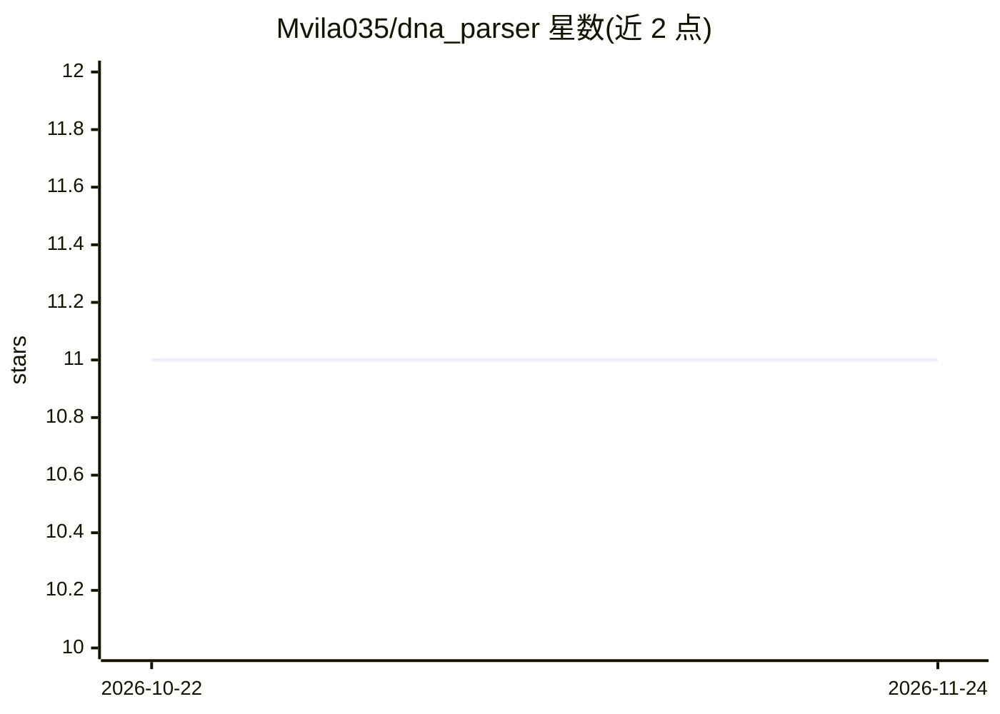

# Mvila035/dna_parser

⭐ 11 · Rust · MIT · 推送 2026-11-17 · [GitHub](https://github.com/Mvila035/dna_parser) · 个人维护

**用 Rust 编写的 DNA 序列编码 Python 库，服务机器学习**

dna-parser 是一个以 Rust 实现核心、以 Python 库形式提供的工具，用于对 DNA/RNA 序列进行编码或特征提取，输出供机器学习使用。提供 SequenceReader 读取序列文件，支持 batch_size 分批处理超大文件避免内存溢出；编码函数可接受任意可迭代对象、pysam FastxFile 与 Biopython SeqIO 对象，支持序列填充/截断与并行编码以缩短耗时。通过 pip 安装，无可用 wheel 时需安装 Rust 后本地编译。

## 筛选速览

| 维度 | 判定 | 备注 |
|---|---|---|
| AI 角色 | `ai-native` | 本体是模型或模型工具 |
| 许可风险 | `permissive` | MIT |
| 部署形态 | `library` | 以包/库形式分发 |
| 模型依赖 | — | README 未给出锁定关系 |
| 硬件要求 | — | 无带数字的原话,不猜 |
| 安装摩擦 | `low` | 无编译、无系统依赖或容器化 |
| 成熟度 | — | 结构信号不足 |

## 能力要点

- Rust 实现、Python 接口，对 DNA/RNA 序列做编码与特征提取
- SequenceReader 读取序列文件，batch_size 分批处理超内存文件
- 兼容 pysam FastxFile 与 Biopython SeqIO 输入
- 支持填充/截断与并行编码

## 适用场景

- 为基因组序列机器学习任务生成编码特征
- 分批读取超出内存的大规模 FASTA/FASTQ 文件
- 在 Python 数据流水线中对接 pysam/Biopython 处理序列

## 场景标签

 · 领域:生物信息/机器学习特征工程

## 证据(README 行号)

> L3:  dna-parser is a Python library written in Rust to encode (or perform feature extraction on) DNA/RNA sequences for m
> L43: Encoding functions accept any iterables (list, set, tuple etc.) containing strings. It also accepts dna-parser `Seq

## 星数曲线

2026-10-22 11 → 2026-11-24 11（+0）

---
*卡片 v1 · prompt 1.4 · 生成 2026-11-19 · 置信度 high · 依据 README sha `b1398eaacbbe` · [字段定义](../../DATASET.md)*
