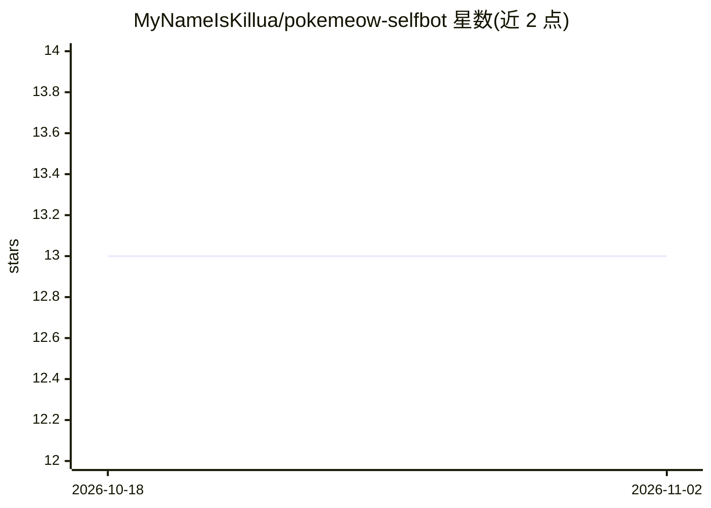

# MyNameIsKillua/pokemeow-selfbot

⭐ 13 · Python · 推送 2026-08-18 · [GitHub](https://github.com/MyNameIsKillua/pokemeow-selfbot) · [官网](https://mynameiskillua.de) · 个人维护

**PokeMeow 自动捕捉 Discord selfbot，含本地 AI 验证码求解**

面向 PokeMeow 游戏玩家的 Python 自动化 selfbot：自动捕捉/钓鱼/日常任务/道具补给/多账号与代理支持，通过 16 个远程控制命令操作。其中 AI 部分：内置 ONNX 格式的 CatchBot 验证码求解模型（约98%识别率，本地运行，模型需从 Releases 单独下载），可选用 2Captcha、Anti-Captcha 或手动模式替代。README 明确警告 selfbot 违反 Discord 服务条款，可能导致永久封号，且 CatchBot 已被 PokeMeow 检测到。仅支持 Windows 10/11 64 位，从 Python 源码运行。

## 筛选速览

| 维度 | 判定 | 备注 |
|---|---|---|
| AI 角色 | `ai-enhanced` | 去掉 AI 部分产品仍成立 |
| 许可风险 | `none` | — |
| 部署形态 | `desktop` | 安装包/桌面程序 |
| 模型依赖 | — | README 未给出锁定关系 |
| 硬件要求 | — | 无带数字的原话,不猜 |
| 安装摩擦 | `low` | 无编译、无系统依赖或容器化 |
| 成熟度 | — | 结构信号不足 |

## 能力要点

- 按稀有度自动捕捉与智能球选择，含事件宝可梦检测
- 本地 ONNX AI 验证码求解（约98%识别率），可选 2Captcha/Anti-Captcha/手动模式
- 多账号启动器，每账号独立配置/统计/日志，支持 HTTP/SOCKS5 代理
- 16 个远程控制命令（!stop/!stats/!ss 等）与 Webhook 通知

## 适用场景

- 自动完成 PokeMeow 的捕捉、钓鱼与日常任务
- 多账号挂机时通过代理降低关联风险
- 用本地 AI 或打码服务自动处理验证码

## 场景标签

`OCR` · 领域:感知与多模态

## 证据(README 行号)

> L105: - CatchBot AI Solver (~98% accuracy, free, local) &mdash; **bundled**
> L120: - **Windows 10 / 11** (64-bit) &mdash; the bot uses Windows-only APIs (`winsound`, `msvcrt`, Windows toast)

## 星数曲线

2026-10-18 13 → 2026-11-02 13（+0）

---
*卡片 v1 · prompt 1.4 · 生成 2026-10-31 · 置信度 mid · 依据 README sha `ad48194e5e6b` · [字段定义](../../DATASET.md)*
