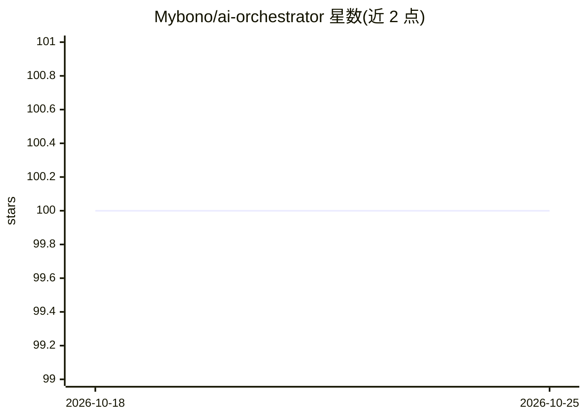

# Mybono/ai-orchestrator

⭐ 100 · NOASSERTION · 推送 2026-07-22 · [GitHub](https://github.com/Mybono/ai-orchestrator) · 个人维护

**多智能体本地 LLM 编排工具，仓库已重置待重建**

定位为配合 Claude Code 与 Ollama 的便携多智能体 AI 开发套件，通过 Bash 按角色编排本地 LLM 完成计划、编码、审查、提交流程，自称零依赖、语言栈无关。但当前 README 声明仓库已被重置：旧版本不再提供，现存内容仅为法律、社区与安全方面的基础文件，新核心引擎正在私有开发中，尚未发布。描述中的功能目前无法从 README 验证。

## 筛选速览

| 维度 | 判定 | 备注 |
|---|---|---|
| AI 角色 | `ai-ecosystem` | LLM/agent 周边工具 |
| 许可风险 | `none` | NOASSERTION |
| 部署形态 | `None` |  |
| 模型依赖 | — | README 未给出锁定关系 |
| 硬件要求 | — | 无带数字的原话,不猜 |
| 安装摩擦 | `low` | 无编译、无系统依赖或容器化 |
| 成熟度 | `idea` | |

## 能力要点

- README 声明仓库已重置，旧版本不再提供
- 新核心引擎正在私有开发中，当前仅为基础框架文件
- 描述中称通过 Bash 按角色编排本地 LLM（不可在 README 验证）

## 适用场景

- 关注其后续多智能体本地 LLM 编排能力的发布
- 了解项目重建进展公告

## 场景标签

`多智能体` `编码 Agent` · 领域:Agent 开发

## 证据(README 行号)

> L13: No further details yet. What's here today is scaffolding: legal, community, and security basics. The rest is being 

## 星数曲线

2026-10-18 100 → 2026-10-25 100（+0）

---
*卡片 v1 · prompt 1.4 · 生成 2026-10-23 · 置信度 low · 依据 README sha `e4cdecf64b50` · [字段定义](../../DATASET.md)*
