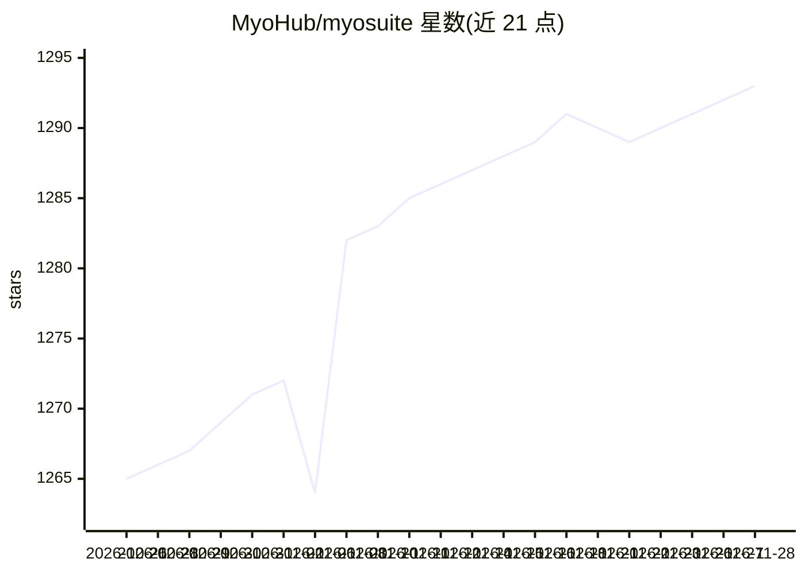

# MyoHub/myosuite

⭐ 1,293 · Python · Apache-2.0 · 推送 2026-11-27 · [GitHub](https://github.com/MyoHub/myosuite) · [官网](https://www.myosuite.org) · 组织维护

**基于 MuJoCo 的肌肉骨骼 RL 环境套件，服务运动控制研究**

以 MuJoCo 物理引擎模拟肌肉骨骼模型，并封装为 Gymnasium API 的环境与任务集合，覆盖肘、指、手、臂、腿与全身等部位，含 Baoding、Relocate 等 MyoChallenge 任务。同一 env_id 支持 CPU（Gymnasium/Stable-Baselines3）与 GPU（mjlab/MJX）两种后端；运动噪声、疲劳、肌肉减少症等肌肉状态以 wrapper 形式施加。附带预训练策略检查点、训练脚本与教程 notebook，面向生物力学、神经科学与机器学习方向的研究者。

## 筛选速览

| 维度 | 判定 | 备注 |
|---|---|---|
| AI 角色 | `ai-native` | 本体是模型或模型工具 |
| 许可风险 | `permissive` | Apache-2.0 |
| 部署形态 | `library` | 以包/库形式分发 |
| 模型依赖 | — | README 未给出锁定关系 |
| 硬件要求 | — | 无带数字的原话,不猜 |
| 安装摩擦 | `low` | 无编译、无系统依赖或容器化 |
| 成熟度 | — | 结构信号不足 |

## 能力要点

- 同一 env_id 跨 CPU 与 GPU 后端的肌肉骨骼环境
- 肌肉状态（噪声/疲劳/肌肉减少症/传入神经再生）作为 wrapper 特征
- MyoChallenge 全套任务以 Gymnasium 环境提供
- Hugging Face 上的默认预训练策略与教程

## 适用场景

- 训练和评估肌肉骨骼运动控制的 RL 策略
- 模拟疲劳、运动噪声等神经肌肉条件做研究实验
- 生物力学与康复方向的肌肉骨骼仿真教学

## 场景标签

`教程课程` `模型训练` `强化学习` · 领域:学习与行业

## 证据(README 行号)

> L11: **MyoSuite** is a collection of musculoskeletal environments and tasks simulated with the MuJoCo physics engine. It
> L21: - **One task, several backends.** The same `env_id` runs on your **CPU** through the standard Gymnasium interface (
> L71: env = make_env("myoElbowPose1D6MRandom-v0")

## 星数曲线

2026-10-26 1,265 → 2026-11-28 1,293（+28）

---
*卡片 v1 · prompt 1.4 · 生成 2026-11-23 · 置信度 high · 依据 README sha `333a2d17444d` · [字段定义](../../DATASET.md)*
