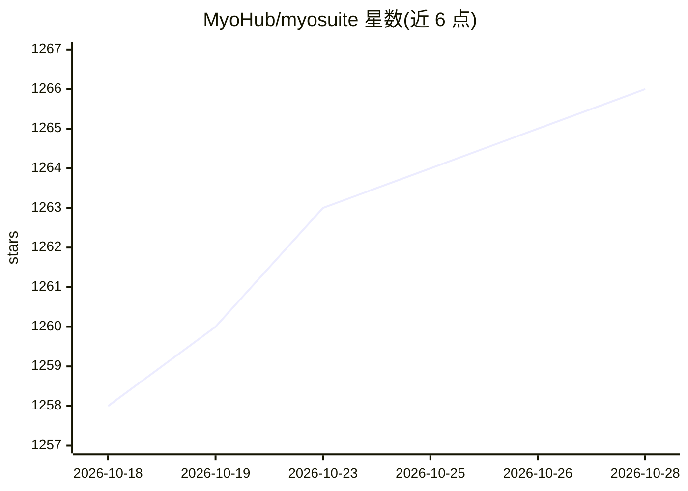

# MyoHub/myosuite

⭐ 1,267 · Python · Apache-2.0 · 推送 2026-10-28 · [GitHub](https://github.com/MyoHub/myosuite) · [官网](https://www.myosuite.org) · 组织维护

**基于 MuJoCo 的肌肉骨骼运动控制仿真环境集合，供 RL 研究**

MyoSuite 提供一组用 MuJoCo 物理引擎模拟、封装为 Gymnasium API 的肌肉骨骼环境与任务，覆盖肘、手指、手、臂、腿与全身（MuscleMimic）。同一 env_id 可在 CPU（配合 Stable-Baselines3）经 mjlab 后端做大规模 GPU 并行训练，另有实验性 MJX (JAX) 路径；肌噪声、疲劳、肌少症等以 wrapper 形式提供，并附带 Hugging Face 上的基线策略与教程。面向生物力学、神经科学、机器学习、运动医学与康复领域的研究者。限制：模型绑定 myo-sim 0.2.3 版本，2.x 训练的策略可能需重训；MJX 路径为实验性。

## 筛选速览

| 维度 | 判定 | 备注 |
|---|---|---|
| AI 角色 | `ai-ecosystem` | LLM/agent 周边工具 |
| 许可风险 | `permissive` | Apache-2.0 |
| 部署形态 | `library` | 以包/库形式分发 |
| 模型依赖 | — | README 未给出锁定关系 |
| 硬件要求 | — | 无带数字的原话,不猜 |
| 安装摩擦 | `low` | 无编译、无系统依赖或容器化 |
| 成熟度 | `idea` | |

## 能力要点

- 同一 env_id 跨 CPU（Gymnasium）与 mjlab GPU 并行训练后端
- 肌肉条件（噪声/疲劳/肌少症/再传入）以 wrapper 统一应用于前后端
- MuscleMimic 全身与双手策略，附带 checkpoint 与运动数据集
- Hugging Face 提供默认训练策略与评估视频

## 适用场景

- 用 PPO/SAC/TD3 训练肌肉骨骼运动控制策略
- 研究疲劳、肌少症等肌肉条件对运动控制的影响
- 在单个 GPU 上并行训练数千环境加速 RL 实验
- 加载现成 checkpoint 做策略回放与评估

## 场景标签

`强化学习` · 领域:训练与推理

## 证据(README 行号)

> L11: **MyoSuite** is a collection of musculoskeletal environments and tasks simulated with the MuJoCo physics engine. It
> L22: - **One task, several backends.** The same `env_id` runs on your **CPU** through the standard Gymnasium interface (
> L83: from stable_baselines3 import PPO

## 星数曲线

2026-10-18 1,258 → 2026-10-28 1,266（+8）

---
*卡片 v1 · prompt 1.4 · 生成 2026-10-21 · 置信度 high · 依据 README sha `6c43ea718f8f` · [字段定义](../../DATASET.md)*
