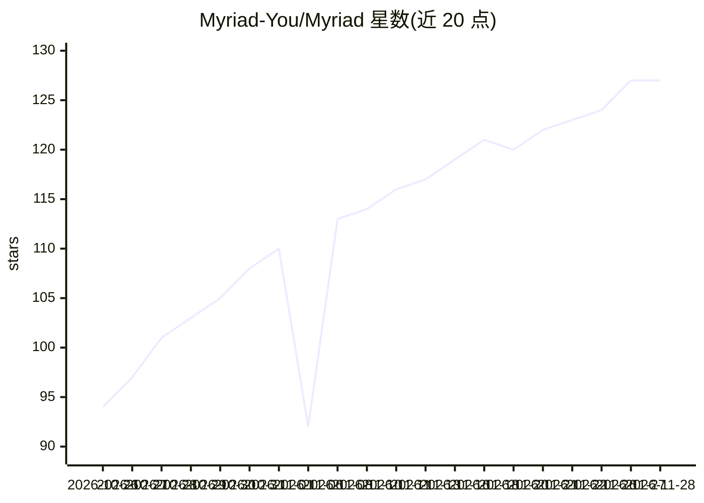

# Myriad-You/Myriad

⭐ 127 · Rust · NOASSERTION · 推送 2026-11-27 · [GitHub](https://github.com/Myriad-You/Myriad) · [官网](https://myriad.you) · 个人维护 · 中文 README

**自托管个人主页：聚合平台数据并运行站内 AI 人格与 Tapp 小应用**

单租户自托管个人主页/创作工作室，后端 Rust、前端 React，数据存 PostgreSQL。聚合 GitHub、Steam、Bilibili、网易云、Bangumi 等 11 个平台数据到同一数据库，供报告卡、资料库与平台报告读取。站内人格拥有 2.5D 面部（浏览器端图层动画，服务端无 GPU 推理）、逐字回复与口型同步；Agent 支持 Chat/Help 两种模式，具备记忆、技能、定时任务与 MCP，并可进入 QQ/Telegram/Discord/飞书群与私信。附带 Hugo 静态博客、ActivityPub/MFP 联邦、Tapp 沙箱小应用与商店/CLI。支持 Docker Compose 部署与版本回滚，提供 ~1 GiB 内存的省内存配置。

## 筛选速览

| 维度 | 判定 | 备注 |
|---|---|---|
| AI 角色 | `ai-enhanced` | 去掉 AI 部分产品仍成立 |
| 许可风险 | `viral` | NOASSERTION |
| 部署形态 | `self-host` | docker 或自建部署 |
| 模型依赖 | — | README 未给出锁定关系 |
| 硬件要求 | — | 无带数字的原话,不猜 |
| 安装摩擦 | `low` | 无编译、无系统依赖或容器化 |
| 成熟度 | — | 结构信号不足 |

## 能力要点

- 11 个平台数据聚合到同一 PostgreSQL 数据库
- 2.5D 人格：浏览器端 Anime2.5DRig 图层动画与口型同步，服务端无 GPU 推理
- Agent 含 Chat/Work 模式，支持记忆、技能、定时任务与 MCP
- Tapp 小应用在带权限审批的沙箱中运行，含商店与 tapp-cli

## 适用场景

- 把各平台动态聚合到一个自托管主页展示
- 给个人站点配置一个可对话、可代办的 AI 人格
- 自托管博客并支持 ActivityPub 联邦关注

## 场景标签

`AI 助手` `聊天机器人` · 领域:对话与助手

## 证据(README 行号)

> L32: **Myriad is a self-hosted personal homepage.** It gathers what you leave on other platforms into one site, and give
> L46: - **Chat and Help**: a long press on empty space opens the panel, and Tab switches between the two modes. In Chat s
> L94: - **Small apps for the site**: a page, a homepage widget, or both. They run in a sandbox with permissions approved 

## 星数曲线

2026-10-26 94 → 2026-11-28 127（+33）

---
*卡片 v1 · prompt 1.4 · 生成 2026-11-28 · 置信度 mid · 依据 README sha `c8fb3204aa4d` · [字段定义](../../DATASET.md)*
