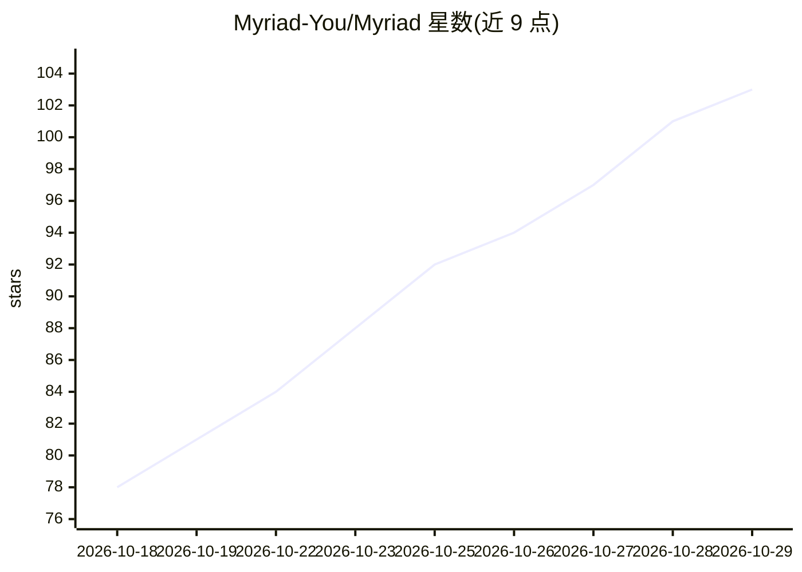

# Myriad-You/Myriad

⭐ 103 · Rust · NOASSERTION · 推送 2026-10-28 · [GitHub](https://github.com/Myriad-You/Myriad) · [官网](https://myriad.you) · 组织维护 · 中文 README

**自托管个人主页与创作工作台：聚合平台数据并运行站点级 AI 角色**

用 Rust/React 构建的单租户自托管个人主页：把 GitHub、Steam、Bilibili、网易云等 11 个平台的数据汇入 PostgreSQL，呈现为可自由布局的网格首页、无限画布式收藏库和 Hugo 静态博客。站点绑定一个站点级 persona：具备 2.5D 分层面部（浏览器端播放、无服务端 GPU 推理）、Chat/Help 双模式对话（Help 含计划-确认-执行、记忆、技能、MCP、定时任务）、由模型从平台数据生成的报告，以及可在沙箱中运行的 Tapp 小应用与生成式 Playground。生产部署为 Docker Compose 多进程架构（proxy + updater），支持 linux/amd64 与 arm64，含版本回滚与约 1 GiB 内存的省内存配置。

## 筛选速览

| 维度 | 判定 | 备注 |
|---|---|---|
| AI 角色 | `ai-enhanced` | 去掉 AI 部分产品仍成立 |
| 许可风险 | `viral` | NOASSERTION |
| 部署形态 | `self-host` | docker 或自建部署 |
| 模型依赖 | — | README 未给出锁定关系 |
| 硬件要求 | — | 无带数字的原话,不猜 |
| 安装摩擦 | `low` | 无编译、无系统依赖或容器化 |
| 成熟度 | — | 结构信号不足 |

## 能力要点

- 11 个平台数据聚合到单一 PostgreSQL，支撑报告卡、收藏库与平台报告
- 站点级 persona：2.5D 面部（浏览器端 Anime2.5DRig，服务端无 GPU 推理）+ Chat/Help 双模式 Agent（含 MCP、记忆、定时任务）
- Tapp 沙箱小应用生态：Playground 生成、商店与 CLI（myriad-tapp）
- ActivityPub + MFP 联邦、TTS/语音收听、OAuth/OIDC 登录与模块级可见性控制

## 适用场景

- 搭建聚合自己各平台动态的个人主页
- 让站点 persona 与访客对话并替我执行授权范围内的工作
- 在站点内管理游戏/动画/书籍收藏库并发布博客
- 运行自己拥有的 Tapp 小应用与首页小组件

## 场景标签

`聊天机器人` `AI 助手` · 领域:对话与助手

## 证据(README 行号)

> L32: **Myriad is a self-hosted personal homepage.** It gathers what you leave on other platforms into one site, and give
> L36: - **Homepage**: a standard 16×4 or free 16×8 grid you lay out yourself; the free layout also takes stickers. Report
> L70:  The library as an infinite canvas: the canvas is dragged and zoomed out, then the categories on the left switch to

## 星数曲线

2026-10-18 78 → 2026-10-29 103（+25）

---
*卡片 v1 · prompt 1.4 · 生成 2026-10-23 · 置信度 high · 依据 README sha `184eb544dc99` · [字段定义](../../DATASET.md)*
