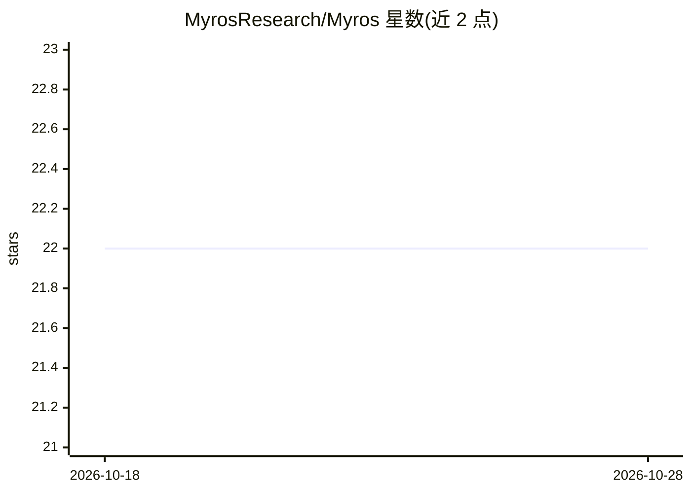

# MyrosResearch/Myros

⭐ 22 · JavaScript · MIT · 推送 2026-07-24 · [GitHub](https://github.com/MyrosResearch/Myros) · [官网](https://myros.live) · 组织维护

**在 Telegram 上部署实时知识问答 AI 机器人的开源启动器**

Node.js 应用，为 Telegram 部署知识感知 AI agent：管理员通过 Telegram 命令添加/移除网站源，机器人用 axios+cheerio 按查询实时抓取网页内容，调用 OpenAI chat-completions 模型生成回答；项目、密码、网站与会话历史持久化于 Postgres。本地开发自动用轮询模式，生产可切换 webhook（需公网 HTTPS）。回答基于子串关键词过滤而非向量检索，知识库仅支持网页，不支持文件上传；每项目共享一个管理员密码。

## 筛选速览

| 维度 | 判定 | 备注 |
|---|---|---|
| AI 角色 | `ai-native` | 本体是模型或模型工具 |
| 许可风险 | `permissive` | MIT |
| 部署形态 | `self-host` | docker 或自建部署 |
| 模型依赖 | — | README 未给出锁定关系 |
| 硬件要求 | — | 无带数字的原话,不猜 |
| 安装摩擦 | `low` | 无编译、无系统依赖或容器化 |
| 成熟度 | `idea` | |

## 能力要点

- 按查询实时抓取指定网站内容（axios + cheerio），5 分钟 TTL 缓存
- 管理员直接在 Telegram 内管理知识库源，无需仪表盘
- OpenAI 模型可配置（模型、温度、token 预算），personality.json 定制人格
- 本地轮询模式开箱即用，生产可切 webhook 模式

## 适用场景

- 为自己的网站搭建 Telegram 实时问答机器人
- 小团队按项目维护多个知识问答 bot
- 低成本部署到 Render/Railway/Fly.io 等托管平台

## 场景标签

`聊天机器人` `文档问答` · 领域:对话与助手

## 证据(README 行号)

> L5: Myros lets you spin up a Telegram bot that fetches live content from websites you control, talks to an OpenAI model,
> L19: - **OpenAI-backed responses** — configurable model, temperature, and token budget

## 星数曲线

2026-10-18 22 → 2026-10-28 22（+0）

---
*卡片 v1 · prompt 1.4 · 生成 2026-10-27 · 置信度 mid · 依据 README sha `9d8ca01dc427` · [字段定义](../../DATASET.md)*
