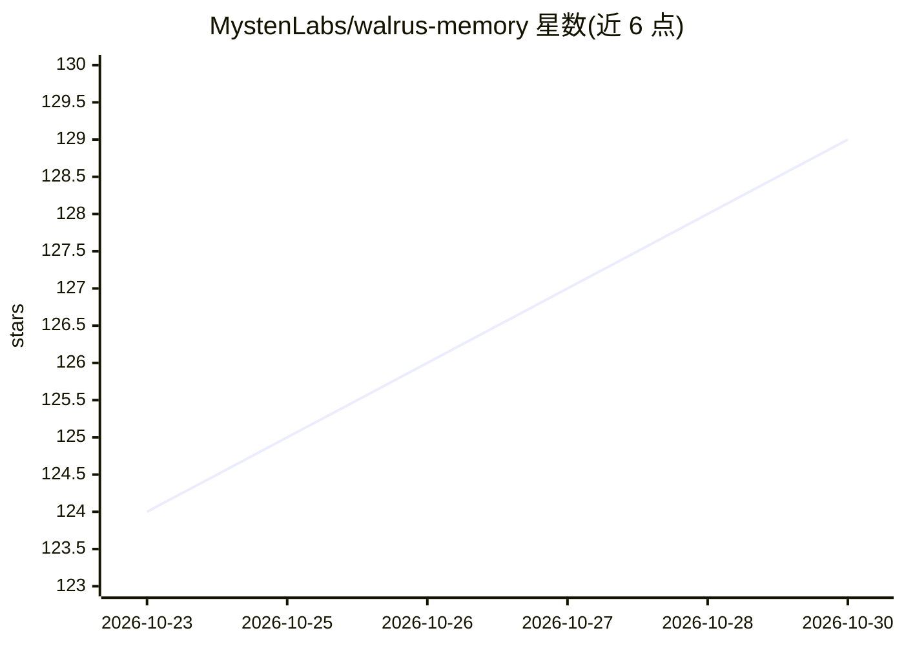

# MystenLabs/walrus-memory

⭐ 129 · TypeScript · Apache-2.0 · 推送 2026-10-29 · [GitHub](https://github.com/MystenLabs/walrus-memory) · [官网](https://walrus.xyz/memory) · 组织维护

**可移植的 AI agent 长期记忆层，跨应用跨会话持久化**

面向 AI agent 的记忆基础设施：通过 relayer 服务处理嵌入、加密、上传至 Walrus 存储、检索与恢复，向量元数据存于 PostgreSQL，按 owner + namespace 划分记忆作用域。记忆数据可验证、由用户控制，支持跨应用与会话迁移。提供 TypeScript SDK（npm 包），含默认客户端、手动流程客户端与 Vercel AI SDK 中间件集成，另有 OpenClaw agent 记忆插件。项目自述处于 beta 阶段，仍在迭代。

## 筛选速览

| 维度 | 判定 | 备注 |
|---|---|---|
| AI 角色 | `ai-ecosystem` | LLM/agent 周边工具 |
| 许可风险 | `permissive` | Apache-2.0 |
| 部署形态 | `library` | 以包/库形式分发 |
| 模型依赖 | — | README 未给出锁定关系 |
| 硬件要求 | — | 无带数字的原话,不猜 |
| 安装摩擦 | `low` | 无编译、无系统依赖或容器化 |
| 成熟度 | `idea` | |

## 能力要点

- relayer 统一处理嵌入、加密、Walrus 上传/下载与检索
- owner + namespace 作用域隔离与增量索引重建
- Vercel AI SDK 中间件集成（streamText/generateText）
- OpenClaw 插件提供自动记忆捕获与召回钩子

## 适用场景

- 让我的 agent 在不同应用和会话间保留记忆
- 为多 agent 系统提供可验证的共享长期记忆
- 通过 Vercel AI SDK 给现有 LLM 应用加记忆层

## 场景标签

`Agent 记忆` · 领域:Agent 开发

## 证据(README 行号)

> L5: Walrus Memory enables AI agents to operate reliably across apps and sessions,
> L82: |`@mysten-incubation/memwal`|Default client (`MemWal`). The relayer handles embedding, encryption, Walrus upload/do

## 星数曲线

2026-10-23 124 → 2026-10-30 129（+5）

---
*卡片 v1 · prompt 1.4 · 生成 2026-10-23 · 置信度 high · 依据 README sha `ca5d0b031399` · [字段定义](../../DATASET.md)*
