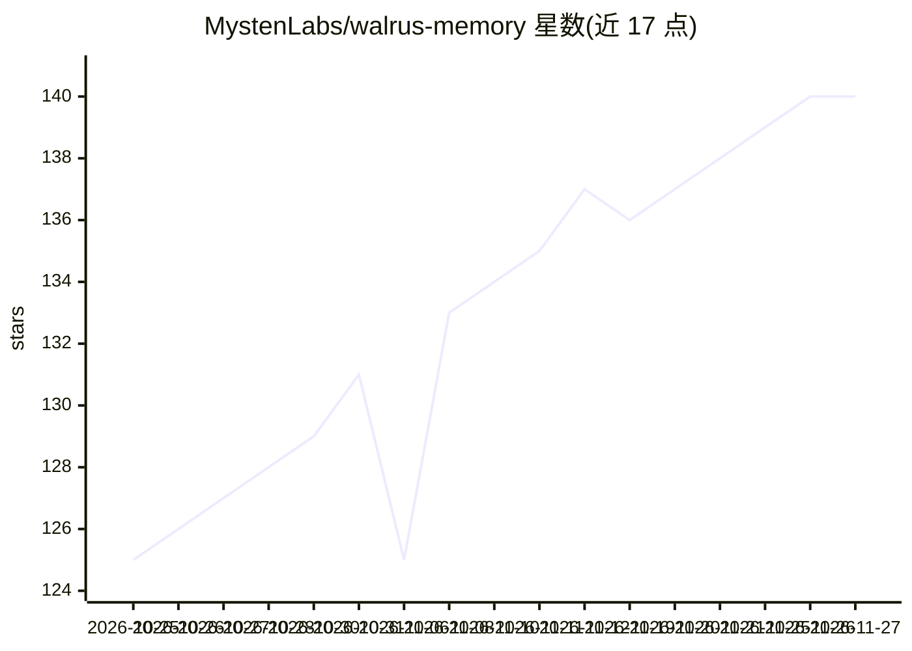

# MystenLabs/walrus-memory

⭐ 140 · TypeScript · Apache-2.0 · 推送 2026-11-26 · [GitHub](https://github.com/MystenLabs/walrus-memory) · [官网](https://walrus.xyz/memory) · 组织维护

**为 AI Agent 提供跨应用跨会话的持久化记忆层**

Walrus Memory 是一个可移植的 Agent 记忆层 SDK，使 AI Agent 在跨应用、跨会话时保持上下文。工作流程分为四步：scope 按 owner+namespace 边界隔离、store 由 relayer 嵌入并加密后上传至 Walrus 并将向量元数据存入 PostgreSQL、recall 按 owner+namespace 检索并返回明文结果、restore 增量重建索引。架构包含 Rust relayer、Node.js sidecar（Seal/Walrus）、Sui indexer、React dashboard 和本地 MCP 连接器，使用 pgvector 与 Redis。npm 安装，当前处于 beta。

## 筛选速览

| 维度 | 判定 | 备注 |
|---|---|---|
| AI 角色 | `ai-ecosystem` | LLM/agent 周边工具 |
| 许可风险 | `permissive` | Apache-2.0 |
| 部署形态 | `library` | 以包/库形式分发 |
| 模型依赖 | — | README 未给出锁定关系 |
| 硬件要求 | — | 无带数字的原话,不猜 |
| 安装摩擦 | `low` | 无编译、无系统依赖或容器化 |
| 成熟度 | `idea` | |

## 能力要点

- 记忆经嵌入、加密后存储于 Walrus，向量元数据存 PostgreSQL (pgvector)
- owner + namespace 的作用域隔离与增量 restore
- 提供 Vercel AI SDK 中间件集成（streamText/generateText）
- OpenClaw Agent 的记忆插件（自动 recall 与 capture 钩子）

## 适用场景

- 为 Agent 添加跨会话的长期记忆
- 多个 Agent 间共享可验证的记忆数据
- 通过 MCP 连接器为本地 Agent 接入记忆

## 场景标签

`Agent 记忆` · 领域:Agent 开发

## 证据(README 行号)

> L5: Walrus Memory enables AI agents to operate reliably across apps and sessions,
> L84: |`@mysten-incubation/memwal`|Default client (`MemWal`). The relayer handles embedding, encryption, Walrus upload/do

## 星数曲线

2026-10-25 125 → 2026-11-27 140（+15）

---
*卡片 v1 · prompt 1.4 · 生成 2026-11-27 · 置信度 high · 依据 README sha `71e360e7b8b2` · [字段定义](../../DATASET.md)*
