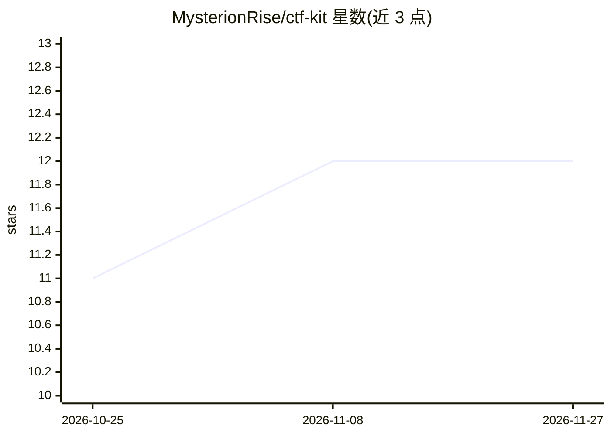

# MysterionRise/ctf-kit

⭐ 12 · Python · MIT · 推送 2026-11-13 · [GitHub](https://github.com/MysterionRise/ctf-kit) · 个人维护

**给 CTF 选手的 AI 辅助解题工具包：插件+CLI**

由 Claude Code 插件与 `ctf` CLI 两层组成：插件中的 `/ctf-kit:*` 技能通过内置脚本调用 xortool、binwalk、volatility3、sqlmap 等安全工具并生成 JSON 摘要供 AI 读取，覆盖 crypto、forensics、stego、web、pwn、reverse、osint 等类别；CLI 负责追踪挑战与比赛进度（init/status/flag/writeup）。提供 team-solve/compete 等实验性多 agent 协作技能。要求 Python 3.11+，无沙箱，README 提示在授权环境与虚拟机/容器中使用。

## 筛选速览

| 维度 | 判定 | 备注 |
|---|---|---|
| AI 角色 | `ai-native` | 本体是模型或模型工具 |
| 许可风险 | `permissive` | MIT |
| 部署形态 | `None` |  |
| 模型依赖 | locked-api |  |
| 硬件要求 | — | 无带数字的原话,不猜 |
| 安装摩擦 | `low` | 无编译、无系统依赖或容器化 |
| 成熟度 | — | 结构信号不足 |

## 能力要点

- 9 个类别的技能封装 20+ 安全工具并输出 JSON 摘要供 AI 读取
- ctf CLI 追踪挑战/比赛进度、记录 flag、生成 writeup
- 实验性 agent team 技能拆分难题与比赛分流
- 通过 Claude Code marketplace 插件机制安装

## 适用场景

- 比赛现场让 AI 辅助分类题型并调用对应工具分析
- 批量管理一场 CTF 中多个挑战的解题进度与 flag 记录
- 赛后整理 writeup 与工具输出

## 场景标签

`网络安全` · 领域:学习与行业

## 证据(README 行号)

> L3: A Claude Code plugin and a CLI for working through CTF challenges with an AI coding agent.
> L61: There are two layers. The plugin skills run their own bundled scripts, which call the tools and
> L69: |`/ctf-kit:analyze`|Detects the challenge type and suggests next steps|file, strings, category detection|

## 星数曲线

2026-10-25 11 → 2026-11-27 12（+1）

---
*卡片 v1 · prompt 1.4 · 生成 2026-11-18 · 置信度 high · 依据 README sha `be62d5fdcc39` · [字段定义](../../DATASET.md)*
