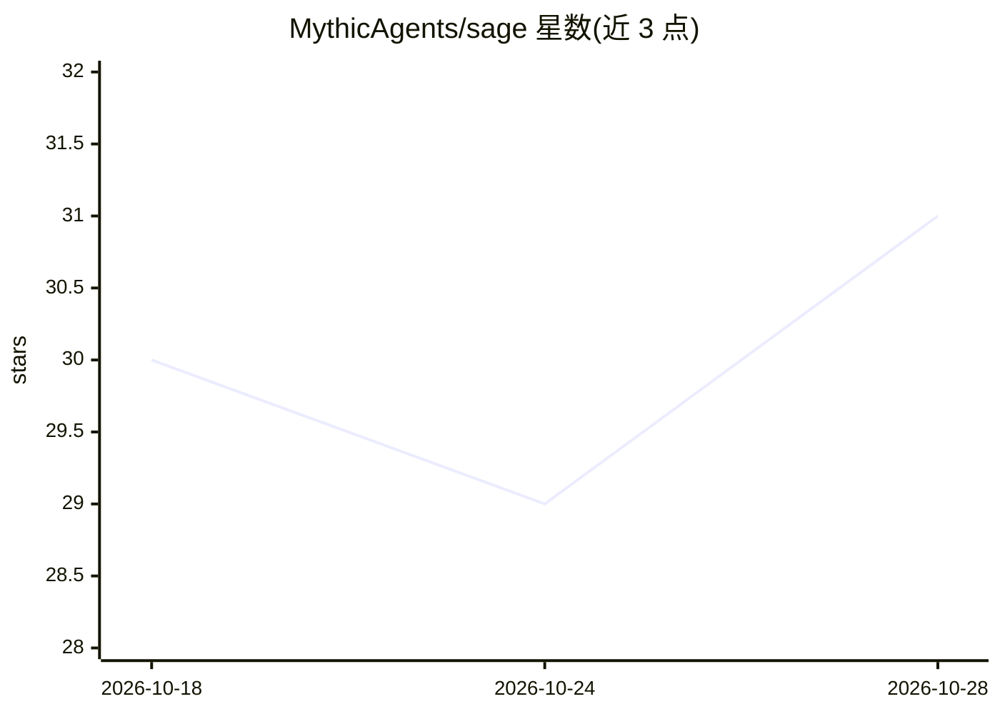

# MythicAgents/sage

⭐ 31 · Python · GPL-3.0 · 推送 2026-10-24 · [GitHub](https://github.com/MythicAgents/sage) · 组织维护

**嵌入 Mythic C2 的 AI 操作员：读作战数据、规划并驱动攻击任务**

Sage 是安装进 Mythic 服务器的原生聊天容器（非独立工具），通过 Mythic API 读取回调、任务、凭据、文件及 BloodHound 图，以 LangGraph 多智能体（Supervisor + 六个专家）执行观察/建模/选择/执行/验证循环，把推理转化为真实 Mythic 任务。提供 conversation（只读）、supervised（人工批准动作）、auto（实验性自主目标，仅 GOAD 验证）三种运行模式。用证据门控的 engagement ledger 持久化每次已验证的攻击跳步（含 proof envelope 与 sha256 哈希），跨上下文重置与换模型保留状态。README 声明仍处于早期（beta 限定 Mythic v4.0.0rc5），自主模式在生产网络存在风险。

## 筛选速览

| 维度 | 判定 | 备注 |
|---|---|---|
| AI 角色 | `ai-native` | 本体是模型或模型工具 |
| 许可风险 | `viral` | GPL-3.0 |
| 部署形态 | `desktop` | 安装包/桌面程序 |
| 模型依赖 | — | README 未给出锁定关系 |
| 硬件要求 | — | 无带数字的原话,不猜 |
| 安装摩擦 | `low` | 无编译、无系统依赖或容器化 |
| 成熟度 | `idea` | |

## 能力要点

- 以 Mythic 原生聊天容器形式安装，通过 Mythic API 驱动回调/载荷/任务等操作面
- LangGraph 智能体图：Supervisor 路由 + Mythic_Operator/Payload/BloodHound/MCP_Manager 等六个专家
- 证据门控 engagement ledger：跳步仅在验证器确认后置为 achieved，附 proof envelope（回调/任务 ID 与 sha256 哈希），跨重启与换模型持久
- 三种权限模式：conversation 只读、supervised 需人工批准、auto 实验性自主（当前仅 GOAD 验证）

## 适用场景

- 红队/授权渗透测试中用自然语言查询当前 Mythic 作战状态并获得有据回答
- 设定目标后让 agent 规划并经批准逐步执行攻击路径
- 多日评估中用 engagement ledger 跟踪已验证的攻击进度并跨会话延续

## 场景标签

`网络安全` `多智能体` · 领域:Agent 开发

## 证据(README 行号)

> L5: **Sage is an AI operator that lives inside your C2.** It reads your live Mythic operation — its callbacks, tasks,
> L11: Concretely, Sage is a chat container for Mythic. It is not a
> L13: function outside one. It gives operators an AI/LangGraph interface to Mythic through its API: it can drive the

## 星数曲线

2026-10-18 30 → 2026-10-28 31（+1）

---
*卡片 v1 · prompt 1.4 · 生成 2026-10-26 · 置信度 mid · 依据 README sha `eeb14fbd06c5` · [字段定义](../../DATASET.md)*
