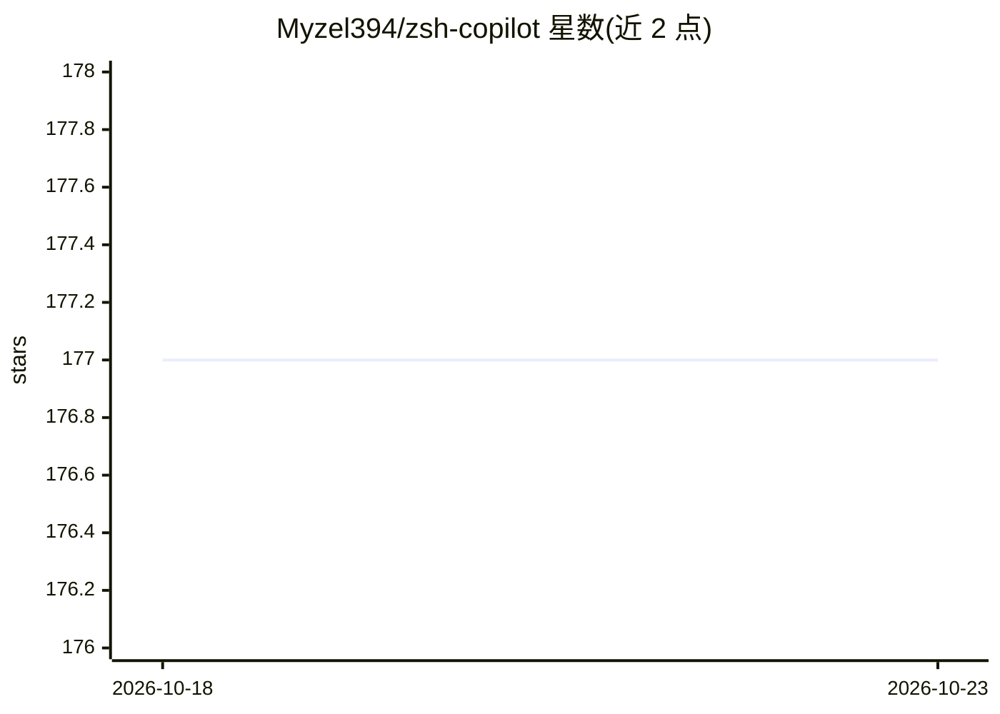

# Myzel394/zsh-copilot

⭐ 177 · Shell · 推送 2026-01-22 · [GitHub](https://github.com/Myzel394/zsh-copilot) · [官网](https://git.myzel394.app/Myzel394/zsh-copilot) · 个人维护

**Zsh 插件：按快捷键将输入交给 LLM 生成命令建议**

Zsh 插件，用户在命令行输入想法或不完整命令后按 CTRL+Z，由 LLM（OpenAI 或 Anthropic API，经环境变量配置）生成建议并直接呈现在 shell 中。依赖 zsh-autosuggestions、jq 和 curl；支持 Oh My Zsh 插件目录安装或手动 clone 加 source 两种方式。可配置触发按键、是否发送上下文信息给模型及调试日志，运行 zsh-copilot 命令可查看全部配置项。使用需自备 OpenAI 或 Anthropic 的 API key。

## 筛选速览

| 维度 | 判定 | 备注 |
|---|---|---|
| AI 角色 | `ai-native` | 本体是模型或模型工具 |
| 许可风险 | `none` | — |
| 部署形态 | `None` |  |
| 模型依赖 | — | README 未给出锁定关系 |
| 硬件要求 | — | 无带数字的原话,不猜 |
| 安装摩擦 | `low` | 无编译、无系统依赖或容器化 |
| 成熟度 | — | 结构信号不足 |

## 能力要点

- CTRL+Z 触发，在 shell 内直接获得 LLM 命令建议
- 支持 OpenAI（默认）与 Anthropic 两种 AI 提供方
- 可配置触发按键、是否发送上下文、调试日志
- 支持 Oh My Zsh 与手动安装两种方式

## 适用场景

- 忘记命令语法时用自然语言描述并获取命令
- 在 shell 内快速生成复杂命令行
- 已用 Oh My Zsh 的用户追加 AI 建议能力

## 场景标签

`代码生成` · 领域:编码与开发

## 证据(README 行号)

> L5: Get suggestions **truly** in your shell. No `suggest` bullshit. Just press `CTRL + Z` and get your suggestion.
> L45: You need to have an API key for either OpenAI or Anthropic to use this plugin. Expose this via the appropriate envi
> L77: Type in your command or your message and press `CTRL + Z` to get your suggestion!

## 星数曲线

2026-10-18 177 → 2026-10-23 177（+0）

---
*卡片 v1 · prompt 1.4 · 生成 2026-10-22 · 置信度 high · 依据 README sha `4bbf48fc1f43` · [字段定义](../../DATASET.md)*
