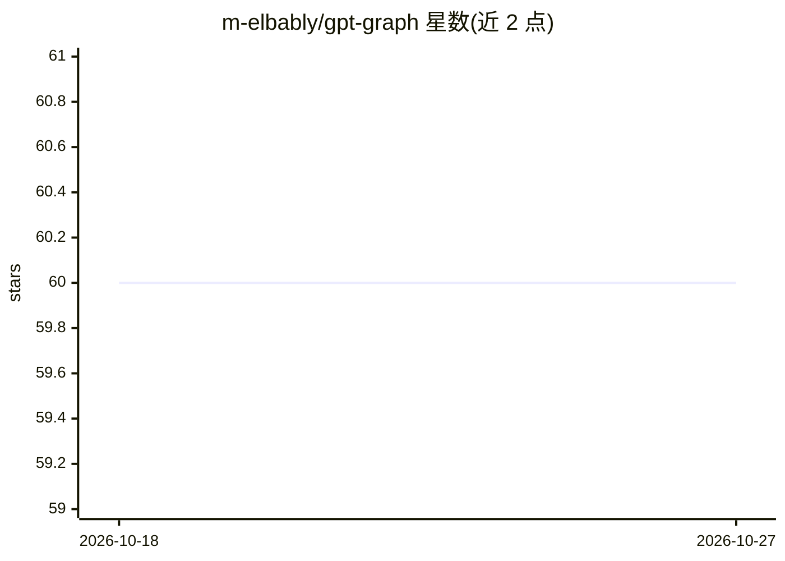

# m-elbably/gpt-graph

⭐ 60 · Vue · MIT · 推送 2026-04-13 · [GitHub](https://github.com/m-elbably/gpt-graph) · [官网](https://m-elbably.github.io/gpt-graph/) · 个人维护

**用 GPT-3.5 生成主题知识图谱的探索工具**

基于 Vite/Vue 的网页工具：输入查询后调用 GPT-3.5 turbo 生成相关主题的图谱节点，节点附带自动生成的提示词用于继续探索，也支持自定义提问与分支；描述以 Markdown 呈现，温度参数默认 0.7。需自行提供 OpenAI API key（经 UI 或 .env 文件），npm install 后 npm run dev 运行。作者声明该项目仅用于演示想法，功能有限且未经测试。

## 筛选速览

| 维度 | 判定 | 备注 |
|---|---|---|
| AI 角色 | `ai-native` | 本体是模型或模型工具 |
| 许可风险 | `permissive` | MIT |
| 部署形态 | `library` | 以包/库形式分发 |
| 模型依赖 | — | README 未给出锁定关系 |
| 硬件要求 | — | 无带数字的原话,不猜 |
| 安装摩擦 | `low` | 无编译、无系统依赖或容器化 |
| 成熟度 | `idea` | |

## 能力要点

- 查询后生成相关主题的知识图谱
- 节点自动生成提示词以扩展探索，支持自定义提问与分支
- 描述以 Markdown 格式呈现
- API key 可通过 UI 或 .env 配置

## 适用场景

- 输入一个主题，展开相关概念的知识图谱
- 沿图谱节点逐步深入探索一个话题

## 场景标签

`知识图谱` · 领域:知识与检索

## 证据(README 行号)

> L7: **GPT Graph** is a simple tool that serves as a knowledge graph explorer utilizing the GPT 3.5 turbo model to help u
> L34: This tool is made just for demonstration purpose of the idea and for how to use LLMs in general, it has very limite

## 星数曲线

2026-10-18 60 → 2026-10-27 60（+0）

---
*卡片 v1 · prompt 1.4 · 生成 2026-10-24 · 置信度 high · 依据 README sha `2f1c291a059a` · [字段定义](../../DATASET.md)*
