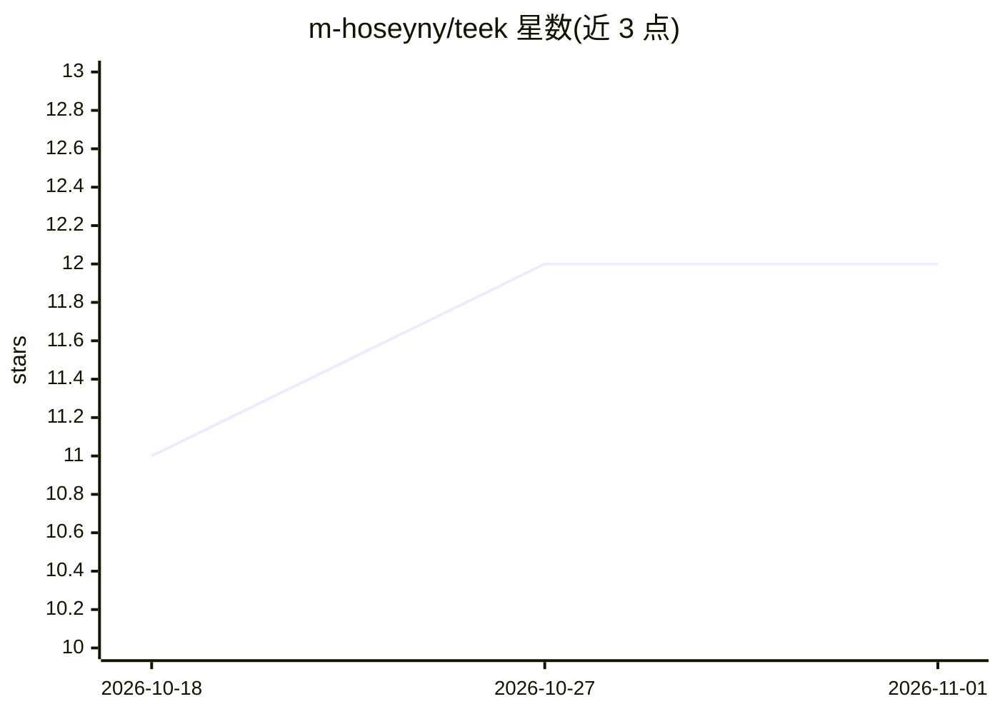

# m-hoseyny/teek

⭐ 12 · TypeScript · AGPL-3.0 · 推送 2026-03-13 · [GitHub](https://github.com/m-hoseyny/teek) · [官网](https://teek.studio) · 个人维护

**自托管的 AI 视频剪辑工具：生成分段短视频与字幕**

基于 SupoClip 修改的自托管 AI 视频剪辑应用，定位为 OpusClip 等付费服务的替代：由 FastAPI 后端负责转录（本地 Whisper / AssemblyAI / 导入 SRT）、片段分析与视频渲染，Next.js 前端负责任务创建与剪辑管理。片段选取可接入任意 LLM 提供商（默认 openai:gpt-5-mini），字幕支持多种样式与 RTL 语言（ASS 引擎），人脸检测使用 MediaPipe/OpenCV 本地运行。通过 start.sh 与 docker-compose 本地部署，AGPL-3.0 许可。README 声明仓库仍在频繁变动、无轻量模型回归评测套件。

## 筛选速览

| 维度 | 判定 | 备注 |
|---|---|---|
| AI 角色 | `ai-native` | 本体是模型或模型工具 |
| 许可风险 | `viral` | AGPL-3.0 |
| 部署形态 | `None` |  |
| 模型依赖 | locked-api |  |
| 硬件要求 | — | 无带数字的原话,不猜 |
| 安装摩擦 | `low` | 无编译、无系统依赖或容器化 |
| 成熟度 | `idea` | |

## 能力要点

- 转录支持本地 Whisper、AssemblyAI 或导入自备 SRT
- 片段选取模型可接入任意 LLM 提供商（默认 openai:gpt-5-mini）
- 多种字幕样式与 ASS 引擎的完整 RTL 语言支持
- MediaPipe + OpenCV 的本地人脸检测，无云端依赖

## 适用场景

- 自托管长视频转病毒式短视频片段
- 生成带样式字幕、可调比例的无水印剪辑
- 本地转录（Whisper）不外发视频内容

## 场景标签

`语音识别` `图像视频处理` · 领域:感知与多模态

## 证据(README 行号)

> L3: Open-source AI video clipping, built as a self-hosted alternative to OpusClip, Veed.io, caption.com.
> L39: - `backend/`: FastAPI service for transcription, clip analysis, and video rendering
> L21: |Transcription providers|Whisper (local), AssemblyAI, or import your own SRT|Proprietary only, no external provider

## 星数曲线

2026-10-18 11 → 2026-11-01 12（+1）

---
*卡片 v1 · prompt 1.4 · 生成 2026-11-01 · 置信度 high · 依据 README sha `854b04b73a09` · [字段定义](../../DATASET.md)*
