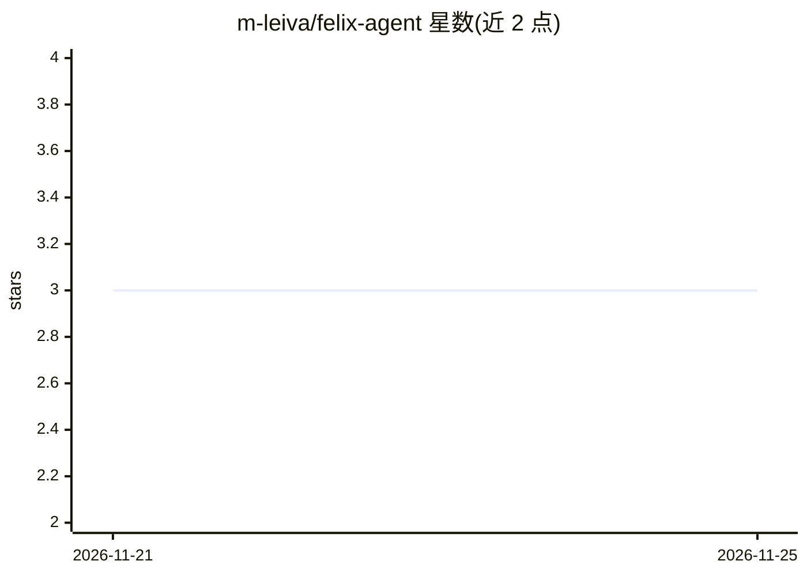

# m-leiva/felix-agent

⭐ — · [GitHub]() · 个人维护

**通过 WhatsApp/Telegram 管理与开发 Linux 服务器的自主 AI Agent**

用 Go 编写的自主 AI Agent 平台，面向 Linux 基础设施的远程管理、系统监控与自主软件开发，通过 WhatsApp 和 Telegram 交互。核心机制包括：LangGraph 风格的状态图引擎与 SQLite WAL 检查点（支持回滚与断点恢复）、内置 AST 仓库映射与模糊 SEARCH/REPLACE 补丁的开发工具链、Git 沙箱分支执行、OpenAI 兼容推理代理（端口 8055，支持密钥池与 429 轮换）、MCP 协议接入、40 个系统工具，以及生成可编译的商业客服 bot（订单/预约）的 BotFactory。运行于 Linux，内存占用声明小于 35 MB。

## 筛选速览

| 维度 | 判定 | 备注 |
|---|---|---|
| AI 角色 | `ai-native` | 本体是模型或模型工具 |
| 许可风险 | `permissive` | — |
| 部署形态 | `library` | 以包/库形式分发 |
| 模型依赖 | local-ok | 支持本地模型 |
| 硬件要求 | — | 无带数字的原话,不猜 |
| 安装摩擦 | `high` | 编译与系统依赖俱全 |
| 成熟度 | — | 结构信号不足 |

## 能力要点

- 状态图引擎 + SQLite WAL 快照：节点级回滚与进程崩溃后恢复
- Go 原生开发工具链：AST 仓库映射、模糊 diff 补丁、Git 沙箱与测试循环
- OpenAI 兼容推理网关（8055 端口）带密钥池与 429 自动轮换
- BotFactory 生成可独立编译的客服 bot，SQLite 确定性算术防幻觉

## 适用场景

- 通过 WhatsApp/Telegram 远程运维 Linux 服务器与诊断系统状态
- 让 Agent 自主完成代码修改、测试与合并的开发任务
- 为餐饮/预约类业务生成独立的客服 bot 微服务

## 场景标签

`Agent 框架` `聊天机器人` `编码 Agent` · 领域:Agent 开发

## 证据(README 行号)

> L3: Félix es una plataforma de agente de inteligencia artificial autónomo de alto rendimiento desarrollada en **Go**, di
> L31: * **Gateway de Inferencia Integrado y Rotación 429 (`internal/inference`):** Servidor proxy compatible con OpenAI (
> L63: git clone https://github.com/m-leiva/felix-agent.git

## 星数曲线

2026-11-21 3 → 2026-11-25 3（+0）

---
*卡片 v1 · prompt 1.4 · 生成 2026-11-21 · 置信度 mid · 依据 README sha `8e198797764b` · [字段定义](../../DATASET.md)*
