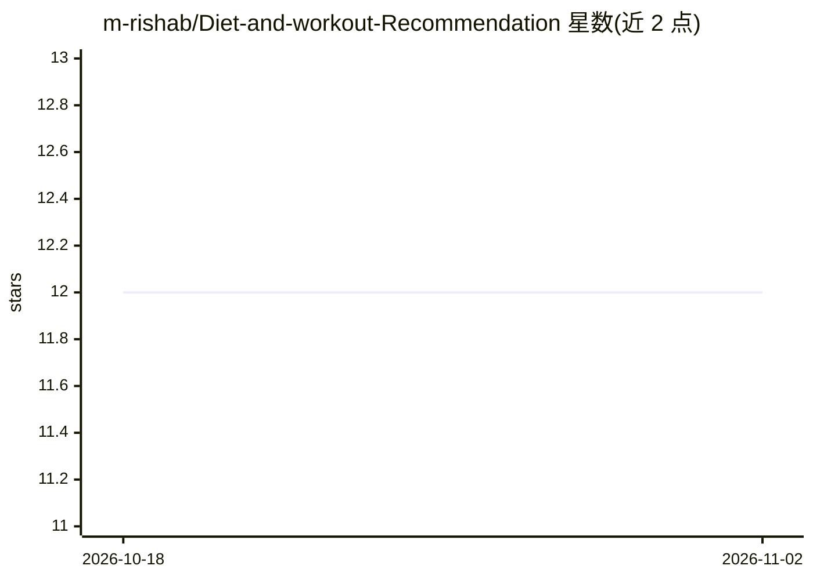

# m-rishab/Diet-and-workout-Recommendation

⭐ 12 · Python · Apache-2.0 · 推送 2026-09-15 · [GitHub](https://github.com/m-rishab/Diet-and-workout-Recommendation) · [官网](https://diet-and-workout-recommendation-using-app-gemini-pro.streamlit.app/) · 个人维护

**基于 LLM 的个性化饮食与健身计划推荐 Web 应用**

Streamlit Web 应用：用户填写年龄、性别、身高体重、地区、饮食偏好、过敏与健康状况，应用在本地计算 BMI/BMR/TDEE 与热量目标，再经 NVIDIA NIM（nemotron-120B，LangChain ChatNVIDIA）以 strict-JSON 提示生成三餐、餐厅、训练计划与周计划，输出经解析与本地兜底目录补全后展示。带过敏/医疗约束的安全护栏、Coach 追问聊天、PDF/JSON 导出，SQLite 持久化；配图通过 DuckDuckGo 等免 key 搜索并验证缓存。需 NVIDIA NIM API key，无本地 GPU。仓库早期版本基于 Google Gemini，现已归档仅留参考。

## 筛选速览

| 维度 | 判定 | 备注 |
|---|---|---|
| AI 角色 | `ai-native` | 本体是模型或模型工具 |
| 许可风险 | `permissive` | Apache-2.0 |
| 部署形态 | `library` | 以包/库形式分发 |
| 模型依赖 | — | README 未给出锁定关系 |
| 硬件要求 | — | 无带数字的原话,不猜 |
| 安装摩擦 | `low` | 无编译、无系统依赖或容器化 |
| 成熟度 | — | 结构信号不足 |

## 能力要点

- 本地计算 BMI/BMR/TDEE/热量目标，LLM 只负责计划生成
- strict-JSON 提示 + JSON 修复循环 + 过敏/医疗约束护栏
- 免 API key 的图片搜索管线（DuckDuckGo/Bing/Wikimedia，相关性评分与下载验证）
- SQLite 持久化、24h 缓存、PDF/JSON 导出与 Coach 追问聊天

## 适用场景

- 输入身体数据获得个性化三餐与训练计划
- 有过敏或医疗状况时获得带约束的饮食建议
- 导出计划为 PDF 并追问细节

## 场景标签

 · 领域:健康/生活应用

## 证据(README 行号)

> L8: Elevate your health journey with our Diet & Workout Recommendation System powered by **NVIDIA NIM** (Nemotron 120B)!
> L13: - **AI-powered insights:** Uses `NVIDIA NIM` (`nvidia/nemotron-3-super-120b-a12b`) with a strict-JSON prompt and lo

## 星数曲线

2026-10-18 12 → 2026-11-02 12（+0）

---
*卡片 v1 · prompt 1.4 · 生成 2026-11-01 · 置信度 high · 依据 README sha `19679d105923` · [字段定义](../../DATASET.md)*
